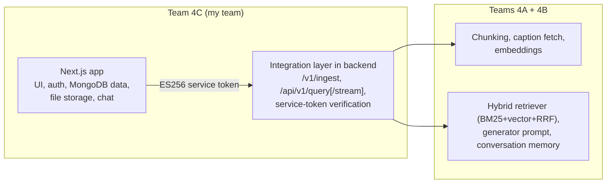

# My Contribution

**Role:** Team 4C member: application, integration and verification
**Project:** Multi-Modal Educational Intelligence Copilot, an industry project at **Accion Labs (2026)**

EduCopilot was a **collaborative** project. This page separates **my Team 4C work** from **the work of Teams 4A and 4B**, so nobody reading it thinks I built the whole platform alone.

---

## 1. How the work was divided

| Team | Built | Where it runs |
|---|---|---|
| **Team 4A** (ingestion) | The original processing of PDFs, documents, video and YouTube into text chunks; chunking; embeddings | Python backend |
| **Team 4B** (RAG) | Hybrid retrieval (BM25 + vectors + RRF), the generation prompt and output format, the Ollama client, conversation memory | Python backend |
| **Team 4C** (application and integration) | The student-facing Next.js application, the integration layer that connects it to the backend, security hardening, and end-to-end verification | Next.js app + integration modules inside the Python backend |

In the final integrated version, Teams 4A and 4B delivered **one joint backend**, and Team 4C integrated with it. An earlier milestone version used separate Team 4A and Team 4B services; see [Architecture verification](docs/architecture/ARCHITECTURE_VERIFICATION.md).

---

## 2. My Team 4C work

Each item below matches work I committed to the integration branch of the team's project repository.

### 2.1 Student-facing application (Next.js, React, TypeScript)

- **Authentication:** sign-up and login with Auth.js (credentials provider, JWT sessions), bcrypt password hashing, rate limits on sign-in and sign-up, logout that revokes the session on the server, and expired-session recovery that brings the student back to the same page.
- **Workspaces:** create, list, open, switch and delete (with cascade cleanup), including the workspace layout with video, chat and materials panels, and mobile tabs.
- **Learning materials:** PDF upload with byte-level progress, YouTube link handling, status polling, retry, delete, duplicate detection (same content or same video), and recovery of items stuck in "processing".
- **AI tutor chat:** streaming answers using the Vercel AI SDK, stop generation, saving failed and stopped questions, optional "draft" preview, per-conversation drafts, and an offline queue.
- **Citation-aware rendering:** mapping backend citations to the student's own files, citation chips, opening PDFs at the cited page, and seeking the video player to the cited timestamp.
- **Conversation history:** sidebar with paging, rename, delete and keyboard accessibility; history restoration after reload.
- **Network awareness:** offline and slow-connection detection and notices.
- **Data layer:** MongoDB models (users, workspaces, conversations, messages, files, revoked sessions), and a script that creates and checks the 12 required indexes.

### 2.2 Integration with the Team 4A/4B backend

- **Service-to-service security:** the Next.js server signs a **short-lived ES256 JWT** (5-minute default) for every backend call. The token names one workspace, one audience and one scope. In the backend I added the **verification module**: it checks the algorithm and key id, signature, issuer, audience, scope, lifetime, and one-time use (replay protection), and it fails closed if keys are not configured.
- **Workspace-scoped ingestion API** (`/v1/ingest`, job status, document delete): fetching only from allowed origins, page-accurate PDF chunks, timestamped YouTube chunks, and "generations" so a re-ingested document never mixes old and new chunks.
- **Workspace-scoped query API** (`/api/v1/query` and `/api/v1/query/stream`): retrieval limited to the token's workspace and the selected sources, follow-up question handling, NDJSON streaming, and **answer verification before streaming** (declines, support check, verifiable citations only).
- **Changes to shared backend modules:** adding workspace scoping to the existing retriever, vector store and conversation memory, so tenant data stays separate from the legacy workbench data.
- **Production hardening:** a backend route allowlist in production mode, safe error responses, startup checks for unsafe configuration, a frontend health endpoint and production environment validation.

### 2.3 Testing and verification

- Frontend unit and component tests (Vitest, React Testing Library) and Playwright browser specs.
- Backend integration tests for the new integration layer (service auth, ingestion, query, streaming, workspace isolation, production hardening).
- Live verification runs: workspace isolation, YouTube timestamp citations, browser end-to-end workflows on desktop and mobile, and the final regression.
- An AI answer-quality benchmark harness used to measure and report answer-quality issues.

### 2.4 Documentation and handover

- Verification reports for each stabilisation task, a complete integrated-project audit, the final technical guide, the deployment and operations handover, and a known-limitations register.
- A **technical handover to Teams 4A/4B** listing open findings in their area (with evidence and suggested investigation), without changing their decisions for them.

---

## 3. What I did **not** build

To be clear:

- The **original retrieval algorithm** (BM25 + vector search + RRF), the **generation prompt**, the **Ollama client** and **conversation memory** were built by **Team 4B**.
- The **original ingestion processors** (PDF, documents, video, YouTube, OCR) and the **chunking** logic were built by **Team 4A**.
- The legacy developer workbench UI inside the backend was built by Teams 4A/4B.

My integration work **reused** these parts. For example, my ingestion API calls Team 4A's chunker and caption fetcher, and my query API calls Team 4B's retriever and generator. I added workspace scoping, verification and the API layer around them.

---

## 4. How my work connects to the other teams

**Diagram: Team 4C components and their connections to Teams 4A/4B**

Team 4C owned both the application and the integration layer that sits inside the backend. The integration layer calls the chunking, caption, retrieval and generation modules built by Teams 4A and 4B instead of replacing them.

---

## 5. Skills this work demonstrates

Full-stack TypeScript (Next.js App Router, React 19), API design, authentication and authorization, JWT and public-key cryptography, MongoDB data modelling, streaming responses, RAG system integration, Python FastAPI, automated testing (unit, component, integration, browser), security hardening, debugging across service boundaries, and technical documentation.
