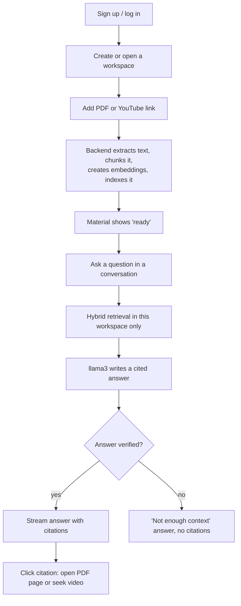

# Project Overview

This document explains what EduCopilot is, why it was built and what it does. You can follow it without reading any code.

---

## 1. Introduction

**Multi-Modal Educational Intelligence Copilot** ("EduCopilot") is a web application where a student uploads their own study material and asks an AI tutor questions about it. The tutor answers **from that material only** and shows **where** each part of the answer came from.

"Multi-modal" here means it works with **two kinds of learning material**:

| Material | How it is understood | How a citation points back to it |
|---|---|---|
| PDF documents | Text is extracted **page by page** | Opens the PDF at the exact **page number** |
| YouTube lectures | The video's **timed captions** are fetched | Seeks the built-in video player to the exact **timestamp** |

It was built at **Accion Labs in 2026** as an industry project by three teams:

| Team | Responsibility |
|---|---|
| Team 4A | Ingestion: turning PDFs and videos into searchable text chunks and embeddings |
| Team 4B | RAG: retrieval, ranking and grounded answer generation |
| **Team 4C** (my team) | The student-facing application, its security, and the integration with the 4A/4B backend |

---

## 2. Problem statement

> Students have large amounts of personal study material in PDFs and long video lectures, but no quick and trustworthy way to get answers from it.

## 3. Problems with traditional study methods

| Traditional method | Problem |
|---|---|
| Reading or scrolling through the PDF | Slow; you need to know where to look |
| Ctrl+F keyword search | Only finds exact words; misses the same idea written differently ("deadlock" vs "processes waiting forever") |
| Scrubbing through a video lecture | Very slow; you cannot keyword-search speech |
| General AI chatbots | Do not know *your* notes; can **hallucinate** (sound confident but be wrong); give no proof |
| Asking a teacher or friend | Not always available |

## 4. Proposed solution

A web app built around **Retrieval-Augmented Generation (RAG)**:

1. The student adds PDFs and YouTube links to a workspace.
2. The system splits the material into small **chunks**, remembers where each chunk came from (page or timestamp), and makes it searchable by **keywords** and by **meaning**.
3. When the student asks a question, the system **finds the most relevant chunks** in *that workspace*.
4. A local language model (**llama3** via Ollama) is instructed to answer **only from those chunks** and to cite them.
5. The answer is **checked**, then **streamed** to the student with clickable citations.
6. If the material does not support an answer, the student gets an honest *"The available documents do not provide enough context to answer this question."*

## 5. Main objectives

1. Answer students' questions from **their own** material.
2. Make grounded answers **verifiable** with page- and timestamp-level citations.
3. Prefer **"I don't know"** over a made-up answer.
4. Keep each student's data **private and isolated**.
5. Give a **responsive** experience: streaming answers, upload progress, clear error messages.

## 6. Target users

- **Primary:** students (school, college, university) studying from notes, textbooks and recorded lectures.
- **Secondary (future):** teachers who want to give students a tutor limited to the course material.

## 7. Major features

### Account and security

| Feature | Description | User benefit |
|---|---|---|
| Sign-up and login | Email and password; passwords hashed with bcrypt | Simple, secure access |
| Rate limiting | Limits on sign-in and sign-up attempts | Protection against password guessing |
| Real logout | The session id is revoked on the server | A logged-out browser cannot reuse the session |
| Session-expiry recovery | An expired session sends the student to log in, then back to the same page | No lost place in the app |

### Workspaces and materials

| Feature | Description | User benefit |
|---|---|---|
| Workspaces | Create, list, open, switch and delete; deletion also removes files, conversations and indexed material | One organised, private space per subject |
| PDF upload | Up to 50 MB, with a byte-level progress bar | Use existing notes directly |
| YouTube links | Captions are indexed (English preferred) | Lecture speech becomes searchable |
| Processing status | *uploading → processing → ready* or *failed*, with Retry and Delete | Always clear what is usable |
| Duplicate detection | The same PDF content or YouTube video is not added twice to a workspace | No duplicate citations or clutter |
| Stuck-item recovery | Items left "processing" after a server crash are recovered automatically | No item stuck forever |
| MP4 rejection | Video-file upload is intentionally not supported and is rejected with a clear message | Honest feedback instead of a silent failure |

### AI tutor chat and history

| Feature | Description | User benefit |
|---|---|---|
| Streaming answers | The answer appears progressively; Stop is available | Responsive, interruptible answers |
| Follow-up questions | "Give me an example" or "what are its advantages?" use the conversation topic | Natural conversation |
| Citations | Numbered chips: a PDF chip opens the page; a YouTube chip seeks the player | Supported statements can be checked at the source |
| Source scope | Limit a conversation to selected materials | Focused answers |
| Saved failures | Failed or stopped questions are kept with their state | Nothing typed is silently lost |
| History | Paged conversation list with rename, delete and keyboard access; reloads after refresh | Easy to revisit past sessions |
| Drafts | Unsent text is kept per conversation | Switching conversations loses nothing |
| Network awareness | Offline and slow-network notices; offline questions are queued and sent in order | Works on unreliable connections |

## 8. System workflow

**Diagram: Student journey from sign-in to a cited answer**

The student first adds material, which the backend turns into searchable chunks. Each question is answered from passages retrieved from that workspace's material. The decision point is the backend's verification step: an answer is shown with citations only when it is supported. Otherwise the student gets an honest "not enough context" reply.

## 9. Technology overview

- **Frontend and its server:** Next.js 16 + React 19 + TypeScript, with Auth.js for login and MongoDB (through Mongoose) for application data.
- **AI backend:** Python FastAPI service with BM25 + Qdrant hybrid retrieval, Reciprocal Rank Fusion, and Ollama running `llama3` and `all-minilm`.
- **Between them:** short-lived ES256-signed service tokens that carry the workspace id.

Details: [TECH_STACK.md](TECH_STACK.md).

## 10. Benefits

- **Saves time:** find answers in seconds instead of scrolling or scrubbing.
- **Checkable:** grounded answers link to their source page or timestamp.
- **Honest:** it declines when the material does not support an answer.
- **Private:** material is isolated per user and workspace, and the models run locally through Ollama.
- **Works with video:** spoken lecture content becomes searchable through captions.

## 11. Scope

**In scope (built):** accounts, workspaces, PDF and YouTube materials, hybrid RAG with citations, streaming chat, history, workspace isolation, local single-machine demo, production-mode hardening for a controlled single host.

**Out of scope (not built):** scanned-PDF OCR, MP4/video-file upload, teacher/admin roles, account deletion, public multi-server deployment, mobile apps.

## 12. Limitations

The most important ones: not production-ready, single host only, open answer-quality issues, no scanned PDFs. Full list: [KNOWN_LIMITATIONS.md](KNOWN_LIMITATIONS.md).

## 13. Future improvements

- Production deployment with HTTPS, managed MongoDB, backups, a secret manager and object storage.
- Shared state (Redis) so the app can scale to several servers.
- OCR for scanned PDFs; transcription for video files and videos without captions.
- Better follow-up answers and fewer false declines.
- Workspace rename, conversation search, account deletion, teacher features.
