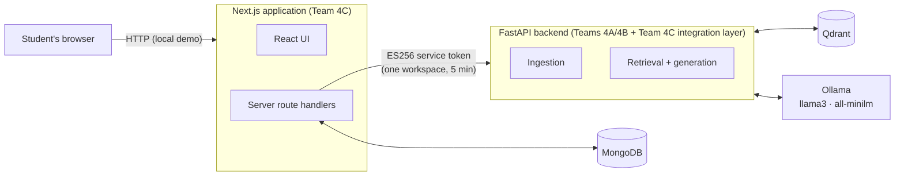

# Multi-Modal Educational Intelligence Copilot

An AI study assistant that answers students' questions using **their own PDFs and YouTube lectures**. Grounded answers include **page-level or timestamp-level citations** to the supporting material. When the material does not contain enough supporting evidence, the tutor declines instead of guessing.

**Industry project at Accion Labs (2026)**, built collaboratively by Teams 4A, 4B and 4C. I was a member of **Team 4C**, which built the student-facing application and integrated it with the AI backend developed by Teams 4A and 4B.

> **Publication scope:** this is a **documentation portfolio**. It explains the system, my Team 4C contribution and the verified test results. It does **not** contain the full application source code, which was written by several people for a collaborative industry project. Publication of the project documentation and approved code excerpts has been approved; the documents include short, abridged code excerpts and source file references. See [Contributions](CONTRIBUTIONS.md).

---

## Problem statement

Students study from long PDFs and hour-long recorded lectures. Finding one answer means scrolling or scrubbing for minutes. Keyword search misses paraphrased ideas, and spoken lecture content cannot be searched at all. General AI chatbots do not know the student's material, may **hallucinate**, and give no way to check their answers.

## Main features

| Feature | Description | User benefit |
|---|---|---|
| Subject workspaces | Private workspaces that hold a subject's materials and conversations | Organised, isolated study spaces |
| PDF materials | Upload PDFs up to 50 MB with a progress bar; duplicate content is detected | Use existing notes directly |
| YouTube materials | Add a lecture link; its timed captions are indexed | Spoken content becomes searchable |
| Grounded AI tutor | Answers are generated from passages retrieved from the workspace and checked against them before display | Answers tied to your own material |
| Citations | A PDF citation opens the cited page; a video citation seeks the player to the timestamp | Grounded answers can be checked at the source |
| Honest refusals | When the material does not support an answer, the tutor says so | Trust over false confidence |
| Streaming chat | Answers stream in; Stop is available; follow-up questions use the conversation context | Responsive conversation |
| Conversation history | Paged list with rename, delete and per-conversation drafts | Pick up where you left off |
| Network awareness | Offline and slow-network notices; offline questions are queued | Works on unreliable connections |

## Architecture

**Diagram: High-level system architecture**

The browser talks only to the Next.js application. The application checks the student's session and workspace ownership in MongoDB, then calls the FastAPI backend with a short-lived signed token that names a single workspace. The backend stores chunk vectors in Qdrant and runs local models through Ollama.

Details: [System architecture](docs/architecture/SYSTEM_ARCHITECTURE.md) · [Data flow](docs/architecture/DATA_FLOW.md)

**Architecture diagram package:** six presentation-quality diagrams (system, ingestion, RAG pipeline, security, database and storage, end-to-end flow) in documentation and 16:9 formats. See the [diagram index](docs/architecture/README.md), or open the [complete system architecture](docs/architecture/complete-system/complete-system-architecture.png) directly.

## Technology summary

| Layer | Technology | Purpose | Usage in EduCopilot |
|---|---|---|---|
| Frontend | Next.js 16, React 19, TypeScript | UI and server route handlers | Pages, chat, materials, video player; secure server-side API layer |
| Authentication | Auth.js v5, bcrypt | Login and sessions | Credentials login, JWT session cookie, session revocation |
| Chat streaming | Vercel AI SDK | Streaming chat state and protocol | `useChat` in the browser; UI message stream from `/api/chat` |
| Database | MongoDB, Mongoose | Application data | Users, workspaces, conversations, messages, files |
| Backend | Python 3.11, FastAPI | AI service API | Ingestion and query endpoints, NDJSON streaming |
| Retrieval | rank-bm25, Qdrant, RRF | Hybrid search | Keyword + vector search merged with Reciprocal Rank Fusion |
| AI models | Ollama, `llama3`, `all-minilm` | Local generation and embeddings | Grounded answers; 384-dimensional vectors |
| Service security | ES256 JWT (`jose`, PyJWT) | Service-to-service authentication | Workspace-scoped, 5-minute tokens verified by the backend |
| Testing | Vitest, Playwright, pytest | Automated testing | Unit, component, integration and browser tests |

Full list and reasoning: [Tech stack](TECH_STACK.md) · [Deep dive](docs/technical/TECH_STACK_DEEP_DIVE.md)

## High-level workflow

1. The student signs in and opens a workspace.
2. They add a PDF or YouTube link. The backend extracts text (per page, or from timed captions), splits it into chunks, embeds the chunks and indexes them.
3. The student asks a question. The Next.js server checks ownership and sends the question with a workspace-scoped token.
4. The backend runs BM25 and vector search over that workspace only and merges the results with RRF.
5. `llama3` writes an answer that must cite the retrieved passages. The backend **verifies** the answer and its citations before streaming it.
6. The application saves the conversation and shows the answer with clickable citations.

Walkthrough: [RAG pipeline](docs/technical/RAG_PIPELINE.md)

## My Team 4C role

As a member of Team 4C, I worked on:

- **The student application:** authentication, workspaces, material management, streaming chat, citation rendering and video seeking.
- **The integration layer:** workspace-scoped ingestion and query APIs in the backend, ES256 service tokens and backend token verification.
- **Security and reliability:** ownership checks, rate limits, session revocation, isolation verification and production-mode hardening.
- **Testing and documentation:** frontend and backend tests, browser workflow testing, verification reports and a technical handover.

Teams 4A and 4B built the original ingestion and RAG backend (chunking, retrieval, ranking, the generation prompt and conversation memory). Details and boundaries: [Contributions](CONTRIBUTIONS.md).

## Verified testing summary

These results were re-run on the final integrated snapshot (21 Nov 2026):

| Check | Result |
|---|---|
| Backend tests (pytest) | 798 passed, 5 skipped, 8 expected failures (xfail), 0 failed |
| TypeScript type check | Clean |
| ESLint | 12 pre-existing problems (9 errors, 3 warnings) |
| Frontend tests (Vitest) | 1,634 of 1,635 passed in the full run; the one failure passed 3/3 when run alone (timing-sensitive) |
| Production build | Succeeded |
| Browser tests, live demo, AI benchmark | Not re-run |

Each suite is reported separately, and not every test passed. Details: [Testing](docs/technical/TESTING.md)

## Documentation

| Area | Documents |
|---|---|
| Overview | [Project overview](PROJECT_OVERVIEW.md) · [Tech stack](TECH_STACK.md) · [Contributions](CONTRIBUTIONS.md) · [Known limitations](KNOWN_LIMITATIONS.md) · [Changelog](CHANGELOG.md) |
| Architecture | [System architecture](docs/architecture/SYSTEM_ARCHITECTURE.md) · [Data flow](docs/architecture/DATA_FLOW.md) · [Diagram package](docs/architecture/README.md) · [Architecture verification](docs/architecture/ARCHITECTURE_VERIFICATION.md) |
| Technical | [Tech stack deep dive](docs/technical/TECH_STACK_DEEP_DIVE.md) · [RAG pipeline](docs/technical/RAG_PIPELINE.md) · [File ingestion](docs/technical/FILE_INGESTION.md) · [Chat and streaming](docs/technical/CHAT_AND_STREAMING.md) · [Database design](docs/technical/DATABASE_DESIGN.md) · [API documentation](docs/technical/API_DOCUMENTATION.md) · [Authentication and security](docs/technical/AUTHENTICATION_AND_SECURITY.md) · [Testing](docs/technical/TESTING.md) |
| Guides | [Setup](docs/guides/SETUP.md) · [Environment](docs/guides/ENVIRONMENT.md) · [Deployment](docs/guides/DEPLOYMENT.md) |
| Learning | [RAG fundamentals](docs/learning/RAG_FUNDAMENTALS.md) · [Vector databases](docs/learning/VECTOR_DATABASES.md) · [BM25, hybrid search and RRF](docs/learning/BM25_AND_HYBRID_SEARCH.md) · [JWT and authentication](docs/learning/JWT_AND_AUTHENTICATION.md) · [LLM streaming](docs/learning/LLM_STREAMING.md) |
| Core subjects | [Overview](docs/core-subjects/README.md) · [Data structures and algorithms](docs/core-subjects/01_Data_Structures_and_Algorithms.md) · [Object-oriented programming](docs/core-subjects/02_Object_Oriented_Programming.md) · [Database management systems](docs/core-subjects/03_Database_Management_Systems.md) · [Operating systems](docs/core-subjects/04_Operating_Systems.md) · [Computer networks](docs/core-subjects/05_Computer_Networks.md) · [Software engineering](docs/core-subjects/06_Software_Engineering.md) · [Computer organization and architecture](docs/core-subjects/07_Computer_Organization_and_Architecture.md) · [Information security](docs/core-subjects/08_Information_Security.md) |
| Interview | [Project explanation](docs/interview/PROJECT_EXPLANATION.md) · [Interview preparation](docs/interview/INTERVIEW_PREPARATION.md) · [Technical questions](docs/interview/TECHNICAL_QUESTIONS.md) · [Why and why not](docs/interview/TECHNOLOGY_WHY_AND_WHY_NOT.md) · [Challenges and solutions](docs/interview/CHALLENGES_AND_SOLUTIONS.md) · [Viva preparation](docs/interview/VIVA_PREPARATION.md) |

## Limitations and scope

- **Not production-ready.** The system ran as a **local demo** on one machine and was never publicly deployed.
- **Single-host design:** uploads on local disk, in-memory rate limits, embedded Qdrant.
- **Open answer-quality issues:** identical answers to some follow-ups, and occasional false "not enough context" replies.
- **Not supported:** scanned (image-only) PDFs and video-file uploads.
- **This repository** has documentation only, no runnable code. [Setup](docs/guides/SETUP.md) describes how the original system was run.

Full list: [Known limitations](KNOWN_LIMITATIONS.md) · Future work: [Project overview §13](PROJECT_OVERVIEW.md#13-future-improvements)

## Acknowledgements

Built at **Accion Labs** as a collaborative industry project by Teams 4A, 4B and 4C. Teams 4A and 4B built the ingestion and RAG backend described in this documentation.
