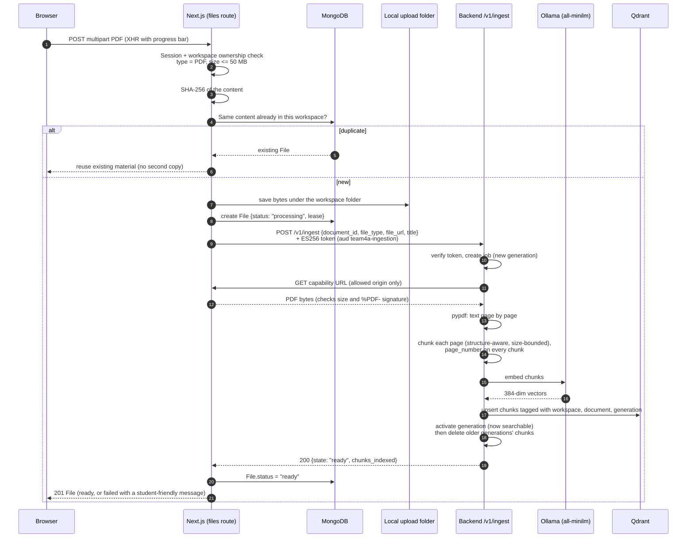
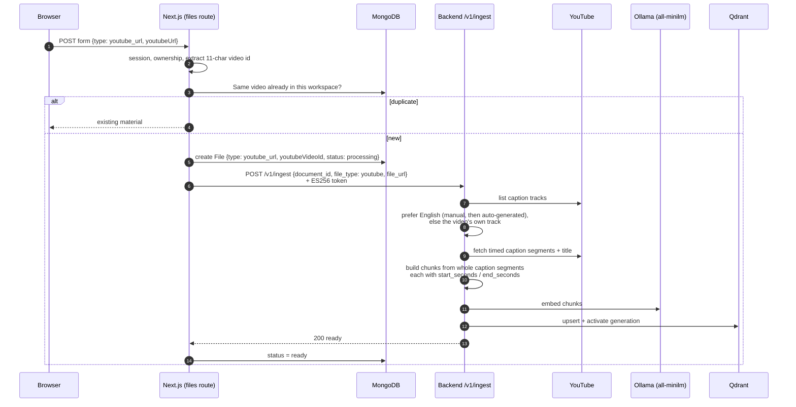
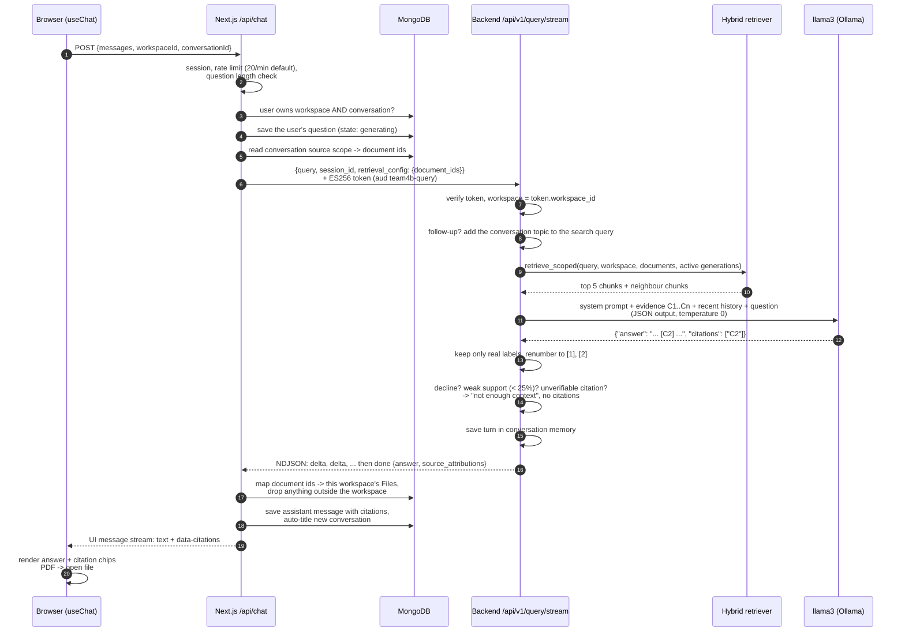
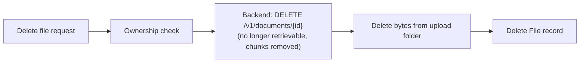

# Data Flow

This document follows the data step by step through the main journeys: adding a PDF, adding a YouTube video, asking a question, and deleting material.

Related: [System architecture](SYSTEM_ARCHITECTURE.md) · [File ingestion](../technical/FILE_INGESTION.md) · [RAG pipeline](../technical/RAG_PIPELINE.md)

Professional diagrams: [Ingestion architecture](ingestion/ingestion-architecture.png) · [End-to-end question and answer flow](end-to-end-flow/question-answer-flow.png)

---

## Diagram 3: PDF ingestion pipeline

In the ingest call, `document_id` is the MongoDB `File._id` and `file_url` is a 10-minute capability URL for the stored PDF.

Important points:

- **The call is synchronous.** The backend answers only after the chunks are indexed and activated, and the upload request waits for it (up to 5 minutes). The materials list also polls status, so other tabs and reloads see the change.
- **Generations** make re-ingestion safe. A failed attempt leaves the previous generation active, and partial chunks are never searchable.
- A **processing lease** (renewed every 30 seconds while the request is alive) lets the app detect files stuck in "processing" after a crash and recover them.
- Pages with no text layer (scanned pages) produce no text. OCR is not part of this path.

---

## Diagram 4: YouTube ingestion pipeline

No file is stored for a YouTube link; the backend fetches the captions itself. The duplicate check uses the video id, so the same lecture is never indexed twice in one workspace. YouTube ingestion is turned on with `INGEST_YOUTUBE_ENABLED=true`. A video without captions cannot be ingested.

---

## Diagram 5: Question answering and citation generation

The question is checked and saved **before** the backend is called, so it is never lost. The backend decides the workspace only from the token. It retrieves, generates, and **verifies before streaming**. The Next.js server then filters citations against the workspace's own files and saves the answer. Step-by-step detail: [Chat and streaming](../technical/CHAT_AND_STREAMING.md#2-what-the-chat-route-does).

### What a citation contains at each step

| Step | Shape |
|---|---|
| Stored chunk metadata (backend) | `source_type: pdf/youtube`, `title`, `page_number` **or** `start_seconds` + `end_seconds` |
| Backend response (`source_attributions`) | `document_id`, `document_title`, `chunk_id`, `relevance_score`, `page_number` **or** `start_timestamp`/`end_timestamp` |
| Saved in MongoDB (`Message.citations`) | `fileId`, `type: pdf/video`, `pageNumber` **or** `timestampSeconds` |
| Shown in UI | file's real name, page or `mm:ss`, a link or seek action |

The display name always comes from **MongoDB** (`File.originalName`), not from the backend. The backend only knows its storage name.

---

## Deleting material or a workspace

**Diagram: Order of operations when a file is deleted**

The backend is cleaned up **first**, so a deleted file can never still be cited. Deleting a workspace repeats this for every file, then deletes its messages, conversations and the workspace itself. Backend conversation sessions are not deleted by a workspace delete; they expire after 30 minutes.

---

## Where data lives

All stores, their owners and how each one isolates workspaces are listed in [Database design §6](../technical/DATABASE_DESIGN.md#6-where-every-piece-of-data-lives).
