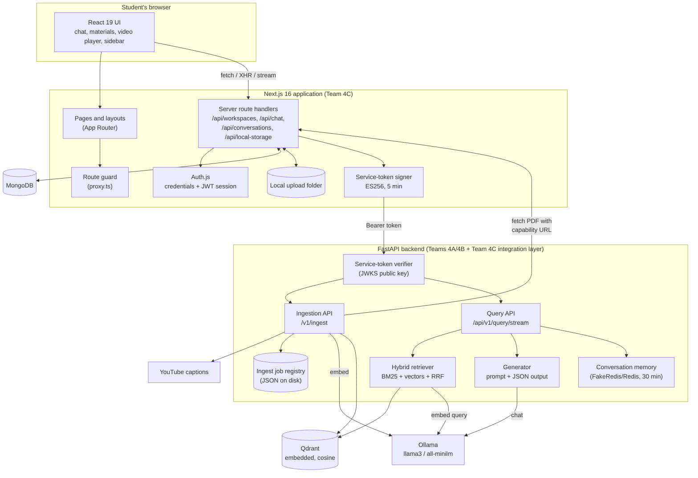
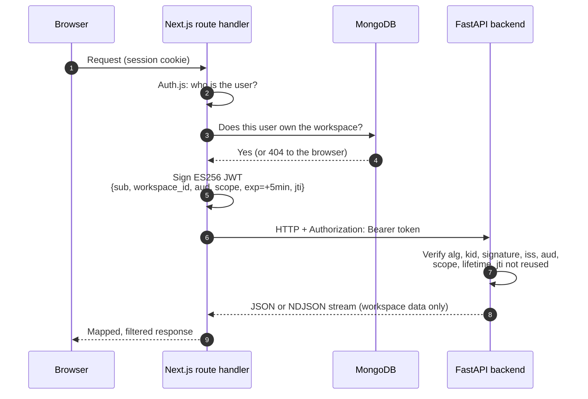

# System Architecture

This document explains how EduCopilot is built: which parts exist, what each part does, and how the parts talk to each other.

Related: [Data flow](DATA_FLOW.md) · [RAG pipeline](../technical/RAG_PIPELINE.md) · [Authentication and security](../technical/AUTHENTICATION_AND_SECURITY.md)

Professional diagrams: [Complete system architecture](complete-system/complete-system-architecture.png) · [all six diagrams](README.md)

---

## A. Overall architecture

EduCopilot has **two application services** and **three supporting systems**:

| # | Part | Built by | Responsibility |
|---|---|---|---|
| 1 | **Next.js application** | Team 4C | Everything the student sees, plus a server layer: login, ownership checks, MongoDB data, file storage, the chat route |
| 2 | **FastAPI backend** | Teams 4A/4B (+ Team 4C integration layer) | Ingestion (extract, chunk, embed, index), retrieval, answer generation and verification |
| 3 | MongoDB | — | Application data: users, workspaces, conversations, messages, files |
| 4 | Qdrant | — | Vector index of all chunks (embedded inside the backend process in the demo) |
| 5 | Ollama | — | Runs the local models: `llama3` for answers, `all-minilm` for embeddings |

### Diagram 1: Complete system architecture



**Key design idea:** the browser **never talks to the AI backend directly**. All backend calls go through the Next.js server, which:

1. knows who the student is (Auth.js session);
2. checks that the student **owns** the workspace in MongoDB;
3. signs a short-lived token that names **only that workspace**.

The backend trusts the workspace in the token and nothing else. Even if someone changed a request body, they could not read another workspace.

### Original team responsibilities vs final integrated structure

| View | Description |
|---|---|
| **Original team responsibilities** | Team 4A: ingestion. Team 4B: retrieval and generation. Team 4C: the student application and its integration |
| **Final integrated structure** (this documentation) | Teams 4A and 4B delivered **one joint FastAPI backend** that serves both ingestion and question answering. Team 4C added the integration layer inside it. Together with the Next.js app, that makes **two application services** |
| **How the app still separates them** | The Next.js server keeps two logical backend clients, "Team A" (ingestion) and "Team B" (query), with separate base URLs (`TEAM_A_API_URL`, `TEAM_B_API_URL`) and separate token audiences. In the integrated demo, both URLs point to the same backend process |

An **earlier milestone version** of the project (M6, September 2026) used **three separately runnable services**: a Team 4A ingestion service with its own job queue, and a separate Team 4B query service. In that version, both backends also read or wrote one field in MongoDB. That design is **not** the final integrated implementation. Details and evidence: [Architecture verification](ARCHITECTURE_VERIFICATION.md).

---

## B. Frontend architecture (Next.js application)

```text
app/
  (auth)/login, signup           Public pages
  (dashboard)/dashboard          Workspace list
  (dashboard)/workspace/[id]     Workspace: video + chat + materials
  api/...                        Server route handlers (the app's own backend)
components/                      chat/, files/, video/, network/, shared/, ui/
hooks/                           useChatStream, useActiveConversation, useSourceScope, ...
lib/                             auth, ownership, serviceJwt, ingestion, validation, rate limits, ...
models/                          Mongoose models
services/                        clients for the backend (real + mock), file storage
store/                           Zustand stores
proxy.ts                         Route guard (Next.js 16 name for middleware)
```

| Concern | How it is handled |
|---|---|
| **Rendering** | App Router pages. Interactive panels are client components |
| **Route protection** | `proxy.ts` redirects signed-out users away from `/dashboard` and `/workspace/*`, keeping a safe callback URL |
| **Server data** | TanStack Query fetches and caches workspaces, files and history from the route handlers |
| **Chat state** | Vercel AI SDK `useChat`, wrapped by a custom hook that adds citations, history seeding, a watchdog, offline replay and retry |
| **Global UI state** | Zustand: active workspace/conversation, offline queue, network quality, toasts |
| **Long lists** | TanStack Virtual renders only the visible chat messages |
| **Video** | video.js with the YouTube tech, so a citation can call "seek to N seconds" |
| **Errors** | Panel error boundaries; 401 responses trigger one sign-out and a redirect to login |

### Server route handlers

The route handlers are a **Backend-for-Frontend (BFF)**: a thin server layer made for this UI. Every data route:

1. reads the Auth.js session (returns **401** if missing);
2. validates input;
3. checks **ownership** in MongoDB (returns **404**, not 403, so it does not reveal that another user's item exists);
4. does the work, which may include calling the backend with a service token.

Full list: [API documentation](../technical/API_DOCUMENTATION.md).

---

## C. Backend architecture (FastAPI)

The backend is **one Python process** containing:

| Layer | Modules (by role) | Built by |
|---|---|---|
| Integration API (used by EduCopilot) | Ingestion API, query API, service-token verification, safe errors, production allowlist | Team 4C |
| Ingestion core | PDF page extraction, YouTube caption fetch, structure-aware chunking, embeddings | Team 4A (reused by the integration API) |
| RAG core | Hybrid retriever, BM25 index, vector store manager, generator, Ollama client, conversation memory | Team 4B (workspace scoping added by Team 4C) |
| Legacy workbench | Earlier developer UI and APIs (document, video, OKF import) | Teams 4A/4B; **blocked in production mode** |

In **production mode** (`ENVIRONMENT=production`), an **allowlist** makes only the integration routes and a `/healthz` probe reachable. Every other path returns 404 before any handler runs, and the API docs pages are turned off.

---

## D. Database interaction

- **Only the Next.js server talks to MongoDB**, through Mongoose models. The backend never reads MongoDB.
- The backend keeps its **own** small stores: Qdrant (chunks and vectors), an ingest **job registry** (JSON files on disk), and conversation memory (in-process FakeRedis in local/demo storage mode; a Redis server only in external mode).
- The two sides share **identifiers**, not databases: the MongoDB `File._id` is the backend's `document_id`, the MongoDB `Workspace._id` is the backend's `workspace_id`, and `Conversation.ragSessionId` is the backend session id.

Details: [Database design](../technical/DATABASE_DESIGN.md).

---

## E. File storage

- Uploaded PDFs are saved by the Next.js server to a **local upload folder**, under the workspace id.
- They are served by `/api/local-storage/...`, which allows access either with the student's session or with a **capability token**: a 10-minute, HS256-signed token bound to that exact workspace and file.
- The backend downloads the PDF through that capability URL (it has no browser cookie), and only from **allowed origins** (`INGEST_ALLOWED_ORIGINS`).
- YouTube materials are not stored as files. Only the link and video id are saved.

This is a **single-host design**. Production would use object storage with presigned URLs (see [Deployment](../guides/DEPLOYMENT.md)).

---

## F. Ingestion architecture (summary)

`POST /v1/ingest` takes `{document_id, file_type, file_url, title}`. For a PDF it fetches the file, extracts text page by page, chunks each page, embeds the chunks, stores them in Qdrant tagged with a new **generation number**, and then **activates** that generation. For YouTube it fetches timed captions and builds timestamped chunks. The request returns only after the material is searchable.

Details: [File ingestion](../technical/FILE_INGESTION.md) and [Data flow](DATA_FLOW.md).

---

## G. Retrieval architecture (summary)

Retrieval always runs inside a **verified workspace scope** (optionally narrowed to selected documents and the active generation of each). It runs **vector search** (Qdrant, cosine) and **BM25 keyword search** in parallel, merges them with **Reciprocal Rank Fusion (k = 60)**, applies a score threshold, keeps the top 5 and adds neighbouring chunks for context.

Details: [RAG pipeline](../technical/RAG_PIPELINE.md).

---

## H. LLM integration

- The backend calls **Ollama** over HTTP. `llama3:latest` generates answers and `all-minilm` creates embeddings.
- The model must return **JSON**: `{answer, citations}`, where citations are evidence labels like `C1`, `C2`. Ollama's structured-output support enforces this.
- Evidence is packed into the prompt within a size budget (context 8,192 tokens, minus 512 reserved for the answer and 512 for overhead). Whole chunks only; a chunk is never cut.

---

## I. Authentication (summary)

- **Students → Next.js:** Auth.js credentials login, bcrypt, JWT session cookie, server-side revocation on logout.
- **Next.js → backend:** ES256 service JWTs, 5-minute lifetime, one workspace, one audience, one scope, single use.

Details and diagrams: [Authentication and security](../technical/AUTHENTICATION_AND_SECURITY.md).

---

## J. Service-to-service communication

### Diagram 2: Frontend-to-backend communication



The ownership check happens in Next.js **before** a token is signed. The backend then verifies the token on its own and never trusts the request body for the workspace. The two checks are independent layers of defence.

| Call | Audience | Scope |
|---|---|---|
| `POST /v1/ingest`, `GET /v1/ingest/jobs/{id}`, `DELETE /v1/documents/{id}` | `team4a-ingestion` | `ingest` |
| `POST /api/v1/query`, `POST /api/v1/query/stream`, session seed/delete | `team4b-query` | `query` |

A token for one audience cannot be used for the other, and every token can be used **once**.

---

## K. Citation generation (summary)

1. Each chunk carries metadata written at ingestion: `source_type`, `title`, and `page_number` (PDF) or `start_seconds`/`end_seconds` (YouTube).
2. The model cites evidence labels (`C1`, `C2`, ...). The backend keeps only labels that really exist, renumbers them `[1]`, `[2]`, ... and builds citations **only from stored metadata**.
3. If a cited chunk lacks valid metadata, the answer is withheld ("fails closed").
4. The Next.js server drops citations to files outside the workspace, then maps each one to the student's file: its real name, URL, page or timestamp.
5. The UI shows chips. A PDF chip opens `file#page=N`; a video chip seeks the player.

Details: [Data flow](DATA_FLOW.md#diagram-5-question-answering-and-citation-generation).

---

## L. Response streaming (summary)

**Backend → Next.js:** NDJSON lines (`delta`, optional `draft`, then exactly one `done` or `error`). The answer is **verified before** the `delta` events are sent.
**Next.js → browser:** a Vercel AI SDK **UI message stream** with text parts and custom data parts (citations, drafts).

Details: [Chat and streaming](../technical/CHAT_AND_STREAMING.md).

---

## Deployment shape (demo)

| Process | Port (local) |
|---|---|
| Next.js | 3000 |
| FastAPI (Uvicorn, one worker) | 8001 |
| Ollama | 11434 |
| MongoDB | local or hosted instance |
| Qdrant | embedded in the backend (folder on disk) |
