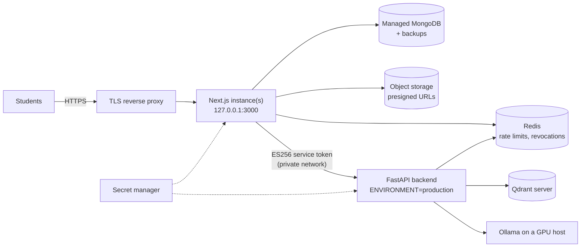

# Deployment

**Current status: EduCopilot has been run only as a local demo on a single machine. It has not been deployed publicly and is not production-ready.**

---

## 1. What exists today

| Environment | Status |
|---|---|
| Local development | Yes |
| Local demo (one Windows machine, launcher script) | Yes, usable with the documented launcher conditions |
| Staging | No |
| Production | **No** |

### Production-mode hardening that *is* implemented

This hardening is designed for a **controlled single host**:

- **Next.js:** startup refuses unsafe configuration (mock backends, localhost fallback URL, missing or short `AUTH_SECRET`, unimplemented storage provider); security headers; optional HSTS; health and readiness endpoints; `start:prod` binds to `127.0.0.1` so that only a reverse proxy can reach it.
- **Backend:** `ENVIRONMENT=production` serves only the integration routes and `/healthz` (allowlist), turns off the API docs, and stops startup on unsafe settings.
- **Database:** a script creates and checks the 12 required indexes.

## 2. What a real production deployment would require

| # | Requirement | Why | Status |
|---|---|---|---|
| 1 | **HTTPS** through a TLS reverse proxy (for example Nginx or Caddy) in front of Next.js | Session cookies and passwords must travel encrypted | Not verified |
| 2 | **Secret management** (cloud secret manager or vault) | No secrets in files on disk | Not done |
| 3 | **Managed MongoDB** with authentication, backups and a tested **restore** | Data durability | Not done |
| 4 | **Live index check** on the production database | Uniqueness rules depend on the indexes | Not done |
| 5 | **Object storage** (S3-compatible) with presigned URLs instead of local disk | Survives server replacement; needed for more than one instance | Not implemented |
| 6 | **Shared state** (Redis) for rate limiters, the token replay cache, revocation memory and conversation memory | Required for more than one instance | Not implemented |
| 7 | **Qdrant as a separate server** (or a managed service) instead of embedded mode | Embedded mode allows one process only | Supported by configuration; not deployed |
| 8 | A **production launcher / process supervisor** (systemd, containers) starting the backend with `ENVIRONMENT=production` and checking `/healthz` | The demo launcher starts development mode and polls a legacy route | Not done |
| — | GPU-capable host for Ollama, or a hosted model endpoint | Acceptable answer speed | Not evaluated |
| — | Monitoring, central logs, alerting | Operations | Not done (backend diagnostics are not even written to the log file yet) |
| — | Key rotation procedure for the service-token keys (`kid` already supported) | Security operations | Not done |

## 3. Target architecture (proposal, not built)

**Diagram: Proposed production architecture (not built)**

Compared with the demo, this design moves every piece of single-process state into shared services (object storage, Redis, a Qdrant server, managed MongoDB). It puts TLS in front of the app and takes secrets from a secret manager. It is a proposal only.

## 4. Why not Vercel / serverless?

The Next.js app stores uploads on **local disk**, the backend is a **long-running** process with an embedded database, and answers can take minutes to stream. Serverless platforms have short time limits and temporary disks. So the intended shape is a **single host behind a TLS reverse proxy**, as recorded in the project's hardening guide.

## 5. Honest summary for interviews

> "We hardened the system for a controlled single-host deployment: startup checks, a route allowlist, security headers and health checks. We ran it as a local demo. We did **not** deploy it publicly. Before production it would need HTTPS, managed MongoDB with backups, a secret manager, object storage, and shared state for scaling."
