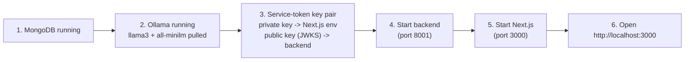

# Setup and Local Development

> **Important: documentation-only repository.**
> - This repository does **not** contain the application source code. The source is excluded because permission to publish it has not been confirmed (see the [README](../../README.md)).
> - This guide describes **how the original integrated system was set up and run locally**, so a reader understands what running it involves.
> - The commands below are **historical and illustrative**. They will **not** run from this repository and are not guaranteed to work as written.
> - Actually running EduCopilot requires the project's source repositories, installed models and a correct environment configuration.
> - The verified setup was a **local demonstration** on one machine, not a production deployment (see [Deployment](DEPLOYMENT.md)).

---

## 1. Environments

| Environment | Status | Description |
|---|---|---|
| **Local development** | Used throughout the project | Each service started by hand; mock backends available for frontend-only work |
| **Local demo** | Used for verification | All services on one Windows machine, started in order by a launcher script with preflight checks |
| **Staging** | **Did not exist** | — |
| **Production** | **Not deployed and not ready** | See [Deployment](DEPLOYMENT.md) |

---

## 2. Prerequisites

| Tool | Version used | Purpose |
|---|---|---|
| Node.js + npm | Node 22 (Next.js 16 needs Node 20+) | Next.js application |
| Python | 3.11 | FastAPI backend |
| MongoDB | Local or hosted instance | Application database |
| Ollama | Recent | Local models |
| Ollama models | `llama3:latest`, `all-minilm` | Answers and embeddings |
| Git | — | Source control |

Docker is **not required**. Qdrant runs embedded inside the backend process in the demo.

---

## 3. Local development modes

### 3.1 Frontend only (mock backends)

The application was built **mock-first**. Each backend client has a mock and a real implementation with the **same TypeScript interface**, selected by an environment flag:

```dotenv
USE_MOCK_TEAM_A=true   # mock ingestion: simulated processing -> ready
USE_MOCK_TEAM_B=true   # mock tutor: streamed answer with sample citations
```

This let Team 4C build and test the full UI before the real backend was ready. Production mode **refuses** to start with mocks enabled.

### 3.2 Full stack

**Diagram: Full-stack startup order**



**Startup order matters:** the backend must be ready before the frontend sends ingestion or query calls.

Typical commands in the original repository (for illustration):

```bash
# Backend (from the backend folder, Python 3.11 virtual environment)
pip install -r requirements.txt
uvicorn app.main:app --host 127.0.0.1 --port 8001

# Frontend (from the Next.js folder)
npm ci
npm run db:indexes        # create the 12 MongoDB indexes once
npm run dev               # development, or: npm run build && npm run start:prod
```

Backend configuration used by the demo (names and non-secret values only; see [Environment](ENVIRONMENT.md)):

```dotenv
STORAGE_MODE=local
QDRANT_LOCAL_PATH=data/qdrant
EMBEDDING_MODEL=all-minilm
VECTOR_SIZE=384
OLLAMA_MODEL=llama3:latest
SCORE_THRESHOLD_DEFAULT=0.25
INGEST_YOUTUBE_ENABLED=true
INGEST_ALLOWED_ORIGINS=<frontend origin>
SERVICE_JWT_JWKS_FILE=<path to public JWKS file>
SERVICE_JWT_ISSUER=<issuer>
```

Frontend configuration (names only):

```dotenv
MONGODB_URI=<secret>
AUTH_SECRET=<secret>
AUTH_URL=<app URL>
USE_MOCK_TEAM_A=false
TEAM_A_API_URL=<backend URL>
USE_MOCK_TEAM_B=false
TEAM_B_API_URL=<backend URL>
SERVICE_JWT_PRIVATE_KEY=<secret>
SERVICE_JWT_KID=<key id>
SERVICE_JWT_ISSUER=<issuer>
SERVICE_JWT_TTL_SECONDS=300
```

### 3.3 The demo launcher

The verified demo used a **PowerShell launcher kept outside the code repository**. It:

1. checked that Ollama was reachable and `llama3:latest` was installed;
2. chose `all-minilm` for embeddings if installed, otherwise `llama3`, and **measured** the vector size with a probe;
3. checked the service-token key pair and that ports 8001 and 3000 were free;
4. started the backend with **no secrets in its environment**, and waited for it to be ready;
5. started Next.js with secrets only in **its** process environment.

That launcher is **not included** here; it contains machine-specific paths and has not been reviewed for publication.

**Known launcher conditions** (from the deployment handover):
- it starts the backend in development mode (not `ENVIRONMENT=production`);
- its readiness check uses a legacy route that returns 404 in production mode (`/healthz` should be used instead);
- `AUTH_URL` and `INGEST_ALLOWED_ORIGINS` must be the **same origin**.

---

## 4. Running tests (in the original repository)

```bash
# Backend
pytest -q

# Frontend
npx tsc --noEmit --incremental false
npx eslint
npx vitest run
npx next build
npx playwright test     # needs the full stack running
```

**Tip:** run backend tests **without** a running backend that uses the same local Qdrant folder. Otherwise they fail with lock errors.

Results: [Testing](../technical/TESTING.md).

---

## 5. Troubleshooting (from project experience)

| Symptom | Likely cause |
|---|---|
| Every backend call returns 503 `auth_unavailable` | JWKS file or issuer not configured (the backend fails closed) |
| Backend 401 on every call | Issuer or key id mismatch between Next.js and the backend, or a clock problem |
| PDF stays "failed" with a fetch error | `INGEST_ALLOWED_ORIGINS` does not match the frontend origin |
| "Query embedding failed" | Ollama not running, embedding model missing, or `VECTOR_SIZE` wrong |
| Tutor always says "not enough context" | No ready materials in scope, threshold too high, or an open answer-quality issue |
| Qdrant "already accessed by another instance" | Two processes using the same embedded Qdrant folder |
