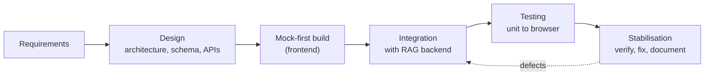
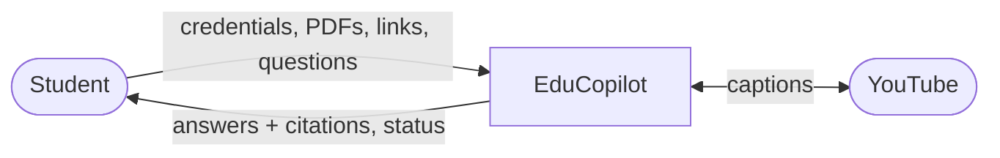

# Viva Preparation (Project Examination)

For a B.Tech project viva: how to present the project, which diagrams to draw, and **exam-style questions** with short answers. Technical interview questions are in [Technical questions](TECHNICAL_QUESTIONS.md). The two sets do not repeat each other.

---

## 1. How to frame the project in a viva

- **Title:** Multi-Modal Educational Intelligence Copilot
- **Type:** Industry project at Accion Labs (2026), built by three teams; I was a member of **Team 4C**.
- **Domain:** EdTech + Artificial Intelligence (Retrieval-Augmented Generation) + full-stack web development.
- **One-line aim:** *"To build a web-based AI tutor that answers students' questions from their own PDFs and YouTube lectures, with verifiable page and timestamp citations for grounded answers and an honest refusal when evidence is insufficient."*

### Objectives (say 4–5)
1. Accept PDFs and YouTube lectures as learning material.
2. Retrieve relevant content using hybrid (keyword + semantic) search.
3. Generate grounded answers with a local LLM, with page and timestamp citations.
4. Refuse to answer when the material does not support an answer.
5. Keep every student's data private through authentication and workspace isolation.

### Methodology
1. **Requirement analysis:** student problems, features and constraints (local, private, free).
2. **Design:** a two-service architecture, database schema, API contracts and a security model.
3. **Implementation:** mock-first frontend development, then integration with the real backend.
4. **Testing:** unit, component, integration, browser end-to-end, accessibility and security tests.
5. **Stabilisation:** live verification tasks that found and fixed defects; documentation and handover.

### Methodology diagram

The loop back from stabilisation to integration shows how the project actually ran: live verification found defects, they were fixed in the integration code, and verification was repeated.

---

## 2. Diagrams to be ready to draw

| Diagram | Where to copy it from |
|---|---|
| System architecture | [System architecture: Diagram 1](../architecture/SYSTEM_ARCHITECTURE.md#diagram-1-complete-system-architecture) |
| Frontend ↔ backend sequence | [Diagram 2](../architecture/SYSTEM_ARCHITECTURE.md#diagram-2-frontend-to-backend-communication) |
| PDF ingestion | [Diagram 3](../architecture/DATA_FLOW.md#diagram-3-pdf-ingestion-pipeline) |
| Question answering + citations | [Diagram 5](../architecture/DATA_FLOW.md#diagram-5-question-answering-and-citation-generation) |
| Hybrid retrieval + RRF | [Diagram 9](../technical/RAG_PIPELINE.md#diagram-9-hybrid-retrieval-and-rrf) |
| ER diagram | [Database design](../technical/DATABASE_DESIGN.md#2-entity-relationships) |
| Login and ownership | [Diagrams 11–12](../technical/AUTHENTICATION_AND_SECURITY.md#diagram-11-authentication-and-authorization-flow) |

**Data flow diagram (DFD) Level 0, for the exam:**

At Level 0 the whole system is one process. The student and YouTube are the only external entities, and the arrows show the main data crossing the system boundary.

---

## 3. Viva questions (exam style)

### About the project

1. **What is the problem statement?** Students cannot quickly get trustworthy answers from their own long PDFs and video lectures; general chatbots don't know their material and can hallucinate.
2. **What is novel or useful about your project?** Answers are grounded in passages retrieved from the student's material, with **page and timestamp** citations that open the source. It refuses when unsupported, and it runs on local models.
3. **What does "multi-modal" mean here?** Two kinds of input material: text documents (PDF pages) and video lectures (timed YouTube captions).
4. **Who are the users?** Students. Teachers are a possible future user group.
5. **What is the scope?** Accounts, workspaces, PDFs and YouTube links, hybrid RAG chat with citations, history, a local demo. Not included: scanned PDFs, video files, production deployment.
6. **What was your individual contribution?** As a Team 4C member: the Next.js application (auth, workspaces, uploads, streaming chat, citations, history), the integration APIs and service-token security in the backend, hardening, testing and documentation.
7. **How did the teams coordinate?** Team 4C built against mock clients with agreed interfaces, then integrated with the real backend. Open issues were handed over with evidence.

### Concepts

For embeddings, RRF and chunking, use [Technical questions](TECHNICAL_QUESTIONS.md) Q56, Q57 and Q62. They are not repeated here.

8. **Define Artificial Intelligence, Machine Learning and an LLM in one line each.** AI: machines doing tasks that need intelligence. ML: learning patterns from data. LLM: a large neural network trained on text to predict and generate language.
9. **What is a token?** A small piece of text (often part of a word) that the model processes. Our model context is 8,192 tokens.
10. **What is hallucination?** When a model produces fluent but false or unsupported content.
11. **What is cosine similarity?** A measure of the angle between two vectors: 1 means same direction (similar meaning).
12. **What is a vector database?** A database that stores vectors and finds the nearest ones quickly, with metadata filters (Qdrant).
13. **What is TF-IDF and how is BM25 better?** TF-IDF weights words by frequency and rarity. BM25 adds saturation (repeats count less) and length normalisation.
14. **What is temperature in an LLM?** It controls randomness. We use 0 for the most consistent, factual output.

### Design and implementation

15. **Draw and explain the architecture.** (Use Diagram 1.) Browser → Next.js (UI + server) → MongoDB; Next.js → FastAPI with an ES256 token → Qdrant + Ollama.
16. **Why did you separate frontend and backend services?** Different strengths (web vs AI ecosystem), separate team ownership, and a clear security boundary.
17. **Explain your database design.** Six collections. The ownership chain is User → Workspace → Conversation → Message and Workspace → File. Citations are embedded in messages. There are 12 indexes, including unique and TTL indexes.
18. **What is normalisation? Did you normalise?** Organising data to reduce redundancy. Core entities are in separate collections linked by ids. Citations are deliberately **embedded** (a controlled denormalisation) because they are always read with their message.
19. **How is a PDF citation opened at the right page?** Every chunk stores its page number. The citation carries it, and the UI opens `file#page=N`.
20. **How is a video citation opened at the right time?** Chunks are built from caption segments with start and end seconds. The UI seeks the player to that time.
21. **How do you ensure one student can't see another's data?** Server-side ownership checks in MongoDB, a signed token naming one workspace, and backend filtering by that workspace. Verified with 118 live checks.
22. **What happens if the answer isn't in the material?** The backend returns "The available documents do not provide enough context to answer this question." with no citations.

### Testing and results

For the testing approach and the exact results, use [Technical questions](TECHNICAL_QUESTIONS.md) Q73 and Q74.

23. **What is the difference between verification and validation?** Verification: "did we build it right?" (tests against the specification). Validation: "did we build the right thing?" (does it solve the student's problem; for example browser workflow runs).
24. **What is regression testing?** Re-running tests after changes to make sure nothing broke. A final integrated regression was run before handover.

### Limitations and future work

25. **What are the limitations?** Not production-deployed; single host; open answer-quality issues; no scanned-PDF OCR; no video-file upload.
26. **What would you do with more time?** A production deployment, Redis for scaling, a re-ranker, OCR and transcription, better follow-up handling, teacher features.
27. **What did you learn?** Integrating services across teams, designing secure service-to-service auth, how RAG really behaves (retrieval quality matters most), and testing failure modes, not just happy paths.

---

## 4. Last-minute checklist

- [ ] Say "Team 4C member" and "collaborative industry project" clearly.
- [ ] Be ready to draw: architecture, RAG pipeline, ER diagram.
- [ ] Know the numbers: 384 dims, k = 60, top 5, ±3 neighbours, 5-minute tokens, bcrypt cost 12, 50 MB PDFs, 798 backend passes.
- [ ] Have one bug story ready (logout race condition).
- [ ] State limitations before you are asked.
