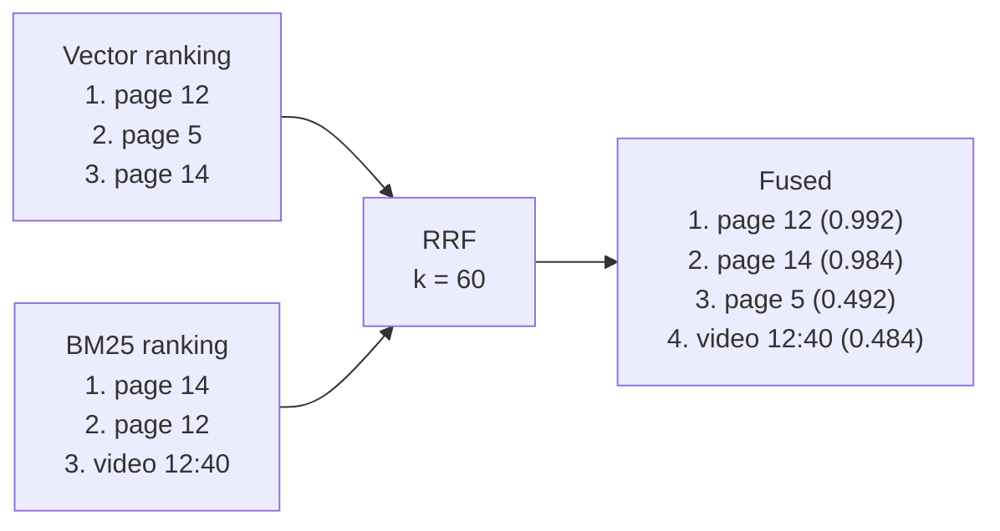

# BM25, Hybrid Search and Reciprocal Rank Fusion

How keyword search works, why EduCopilot combines it with vector search, and how the two rankings are merged.

---

## 1. Keyword search and its problems

The simplest search counts matching words. Two problems:

1. **Common words dominate.** "the", "is" and "process" appear everywhere.
2. **Long documents win unfairly.** More words means more matches.

**TF-IDF** fixed the first problem. **BM25** improves on TF-IDF.

## 2. BM25 in simple words

BM25 gives each chunk a score for a query. A chunk scores **higher** when:

| Factor | Idea | Example |
|---|---|---|
| **Term frequency (TF), with saturation** | The query word appears in the chunk. More often is better, but with **diminishing returns** (10 times is not 10× better than once) | "deadlock" appearing 3 times |
| **Inverse document frequency (IDF)** | The word is **rare** across all chunks, so it carries more meaning | "banker's" is rare, "process" is common |
| **Length normalisation** | Shorter, focused chunks are not punished by long ones | A 3-sentence chunk vs a long one |

The formula (for reference):

```text
score(D, Q) = Σ over query words q:  IDF(q) × [ f(q,D) × (k1 + 1) ] / [ f(q,D) + k1 × (1 − b + b × |D| / avgdl) ]
```

`f(q,D)` = count of q in chunk D, `|D|` = chunk length, `avgdl` = average chunk length. `k1` (saturation) and `b` (length normalisation) are constants. EduCopilot uses the `rank-bm25` library's defaults.

## 3. BM25 in EduCopilot

- Built **on the fly** over the in-scope chunks of the workspace (up to 10,000).
- **Tokens:** lower-cased words matching `\w+`.
- Only chunks that share **at least one** word with the question are kept.
- The list is sorted by BM25 score. Each chunk then gets a score from its **rank** (1, 1/2, 1/3, ...), because raw IDF can be zero or negative in very small collections.
- Known limitation: `\w+` splits some **Indic-script** words incorrectly. This is tracked as an expected test failure.

## 4. Keyword vs vector vs hybrid

| | Keyword (BM25) | Vector | Hybrid |
|---|---|---|---|
| Matches | Same words | Same meaning | Both |
| "Banker's algorithm" | Excellent | Good | Excellent |
| "Why do processes get stuck forever?" (text says "deadlock") | Weak | Excellent | Excellent |
| Needs a model | No | Yes | Yes |

**Hybrid search** runs both and merges the results, so each covers the other's weakness.

## 5. Merging rankings: Reciprocal Rank Fusion

**Problem:** BM25 scores (for example 7.3) and cosine scores (for example 0.81) are on **different scales**. Adding them is meaningless.

**RRF's idea:** ignore the scores and use only the **rank** in each list.

```text
RRF(chunk) = Σ over lists  1 / (k + rank_in_list)        k = 60
```

EduCopilot then divides by the best possible score (`2 / 61` for two lists), so the scores fall between 0 and 1.

**Diagram: Fusing a vector ranking and a BM25 ranking with RRF**



**Worked example**

| Chunk | Vector rank | BM25 rank | Calculation | Normalised |
|---|---|---|---|---|
| page 12 | 1 | 2 | 1/61 + 1/62 = 0.03252 | 0.992 |
| page 14 | 3 | 1 | 1/63 + 1/61 = 0.03227 | 0.984 |
| page 5 | 2 | — | 1/62 = 0.01613 | 0.492 |
| video 12:40 | — | 3 | 1/63 = 0.01587 | 0.484 |

**Why k = 60?** It is the common default from the original RRF paper (Cormack et al., 2009). A large `k` makes 1st and 2nd place differ only a little, so **agreement between lists** matters more than one list's top spot.

## 6. After fusion (EduCopilot)

1. Remove chunks below the **score threshold** (0.5 in the code; **0.25** in the demo).
2. Keep the **top 5**.
3. Add **neighbour chunks** (same document, index within ±3) as extra context.

## 7. Interview-ready answers

- **What is BM25?** "A keyword ranking function. It rewards chunks containing the query words, especially rare words, with diminishing returns for repeats and normalisation for chunk length."
- **Why hybrid?** "Vector search understands meaning but can miss exact terms; BM25 is the opposite. Together they retrieve better than either alone."
- **What is RRF and why use it?** "It merges ranked lists using only ranks: each item gets 1/(k + rank) from each list. We use it because BM25 and cosine scores are on different scales, so adding them directly would be meaningless."
- **Follow-up: what would you try next?** "A cross-encoder re-ranker on the top candidates, or tuning the threshold. The backend already has an optional re-ranking layer, disabled in the demo."
