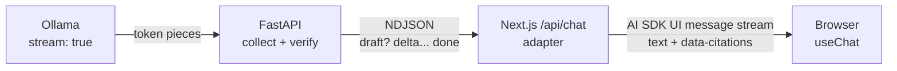

# LLM Streaming Basics

Why and how AI answers are streamed, and how EduCopilot does it. Implementation details: [Chat and streaming](../technical/CHAT_AND_STREAMING.md).

---

## 1. Why stream?

An LLM produces text **token by token** (a token is roughly a word piece). A full answer can take many seconds on a local model.

| Without streaming | With streaming |
|---|---|
| Blank screen until the whole answer is ready | Text appears progressively |
| Feels slow or broken | Feels responsive |
| Cannot stop early | Can **Stop** |

## 2. Ways to stream over HTTP

| Technique | Direction | How | Typical use |
|---|---|---|---|
| **Chunked HTTP response** | Server → client | The response body arrives in pieces | NDJSON, plain text streams |
| **Server-Sent Events (SSE)** | Server → client | `text/event-stream`, `data:` lines | Notifications, AI chat |
| **WebSockets** | Both ways | A persistent socket | Chat rooms, games |

Answer streaming is **one-way** (server to client), so chunked HTTP or SSE is enough. WebSockets would add complexity for no benefit.

## 3. NDJSON

**Newline-Delimited JSON:** one complete JSON object per line.

```text
{"type":"delta","text":"A deadlock "}
{"type":"delta","text":"occurs when..."}
{"type":"done","answer":"...","source_attributions":[...]}
```

It is easy to produce (write a line) and easy to read (split on newlines, then parse each line). EduCopilot's backend streams NDJSON from FastAPI with a `StreamingResponse`.

## 4. EduCopilot's streaming chain

**Diagram: Streaming chain from the model to the browser**



1. **Ollama → backend:** the model's output arrives in pieces. The output is JSON (`{"answer": ..., "citations": [...]}`). For the optional draft preview, the backend decodes only the text of the `answer` field, never raw JSON.
2. **Backend:** waits for the complete output, then **verifies** it (citations, support, declines), then sends the verified answer as `delta` pieces and a final `done` with citations.
3. **Next.js:** converts NDJSON into the **Vercel AI SDK UI message stream**, attaches citations as a custom `data-citations` part, and saves messages.
4. **Browser:** `useChat` updates the message live.

## 5. The trade-off EduCopilot made

| Option | Pro | Con |
|---|---|---|
| Stream raw model text immediately | Fastest first words | The student may see an answer that is then **withdrawn** for failing verification |
| **Verify first, then stream** (chosen) | The student only ever sees **verified** text | The first word appears later |
| Verify first + optional unverified **draft** preview | Shows progress, clearly labelled | Two areas to understand |

An earlier version streamed raw text. A real student-facing problem (an unsupported answer replaced after refresh) led to the change.

## 6. Stopping a stream (cancellation)

1. The student presses **Stop** → `useChat().stop()` aborts the browser's `fetch`.
2. The Next.js route sees the request's **abort signal** and cancels its upstream call to the backend.
3. The question is saved as **`stopped`** with any partial text, so nothing is silently lost.

## 7. Handling failures

- **Error event:** the backend sends `{"type":"error","detail":"llm_unavailable"}` instead of `done`. The UI shows a friendly message, and the question is saved as `failed` with Retry.
- **Stuck stream:** a client-side watchdog notices when progress stops and rebuilds the chat from the saved history.
- **Offline:** questions are queued and sent in order when the connection returns.

## 8. Interview-ready summary

> "The backend gets the model output from Ollama, verifies the full answer and its citations, then streams it to our Next.js server as NDJSON. Next.js converts that into the Vercel AI SDK's UI message stream, adding citations as a data part, and `useChat` renders it live. Stop aborts the fetch, the abort propagates to the backend call, and the question is saved as stopped."
