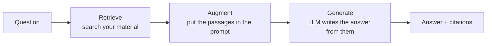

# RAG Fundamentals

A beginner-friendly explanation of **Retrieval-Augmented Generation**. For EduCopilot's exact implementation, see the [RAG pipeline](../technical/RAG_PIPELINE.md).

---

## 1. The problem with a plain LLM

A **Large Language Model (LLM)** such as Llama 3 learned from a huge amount of public text. It is very good at writing fluent language. But:

1. **It does not know your documents.** Your class notes were never in its training data.
2. **It can hallucinate.** It predicts likely-sounding words, so it may invent a fact, a formula or a page number with full confidence.
3. **It cannot show proof.** It does not know *where* a fact came from.

## 2. The idea of RAG, in one picture

Think of an **open-book exam**:

| Closed-book (plain LLM) | Open-book (RAG) |
|---|---|
| Answer from memory | First **look up** the right pages in *your* book |
| May confidently misremember | Write the answer **from those pages** |
| Cannot point to a source | Can say "see page 12" |

RAG = **Retrieve** relevant passages → **Augment** the prompt with them → **Generate** the answer.

**Diagram: The three steps of RAG**

Retrieval finds the evidence, augmentation places it in the prompt, and generation writes the answer from it. Citations are possible because the system knows which passages were supplied.

## 3. The two phases

### Phase 1: Indexing (once per document)
1. **Extract** text (PDF pages, video captions).
2. **Chunk** it into small passages. Small passages make search precise and fit in the prompt.
3. **Embed** each chunk into a vector (a list of numbers that represents its meaning).
4. **Store** the chunks (text + vector + where it came from) in a search index.

### Phase 2: Answering (every question)
1. **Search** for the chunks most related to the question (keyword search, vector search, or both).
2. **Build a prompt:** rules + the top chunks (labelled) + the question.
3. **Generate** the answer with the LLM, citing the labels.
4. **Check** the answer and return it with citations.

## 4. Key terms

| Term | Simple meaning | EduCopilot example |
|---|---|---|
| Chunk | A small passage of a document | A few sentences from page 12 of `OS-Unit3.pdf` |
| Embedding | Numbers that capture meaning | 384 numbers from `all-minilm` |
| Vector database | Stores embeddings and finds the nearest ones | Qdrant |
| Retrieval | Finding relevant chunks | BM25 + vector search, merged with RRF |
| Context window | How much text the model can read at once | 8,192 tokens for llama3 in this setup |
| Grounding | Answering only from given evidence | "Answer only from supplied evidence" rule |
| Citation | Pointer to the source of a claim | `[1]` → page 12, or 12:40 in a video |
| Hallucination | Confident but unsupported output | Reduced (not eliminated) by verification and the "not enough context" answer |

## 5. Why chunking matters

- **Too big:** the search matches a whole chapter, the prompt fills up quickly, and citations become vague.
- **Too small:** a chunk loses its meaning (half a sentence).
- **EduCopilot:** structure-aware chunks (they respect headings and sentences), never crossing a PDF page, with **neighbour chunks** added at answer time to restore context.

## 6. Common failure modes, and what EduCopilot does about them

| Failure | Cause | Mitigation in EduCopilot |
|---|---|---|
| Wrong chunks retrieved | Vocabulary mismatch | Hybrid search (keywords **and** meaning) |
| Model ignores the evidence | LLM behaviour | Strict prompt + support check (≥ 25% of content words must appear in the cited chunks) |
| Model invents citations | LLM behaviour | Only real labels are accepted; metadata comes from storage |
| Answer from another user's data | Missing isolation | Workspace filter from a signed token |
| Prompt injection inside a PDF | Malicious text | Evidence treated as data; answer verified |
| Follow-up "what about its advantages?" fails | No topic words | Topic from the conversation added to the search query |

## 7. RAG vs fine-tuning

| | RAG | Fine-tuning |
|---|---|---|
| Add a new document | Index it (minutes) | Retrain (hours, a GPU) |
| Citations | Natural | Not possible |
| Cost | Low | High |
| Best for | Knowledge that changes, per-user data | Style, format, special skills |

EduCopilot's data is **per student and changes all the time**, so RAG is the right fit.

## 8. Interview-ready summary

> "RAG means we first retrieve the most relevant passages from the student's own material, then ask the model to answer only from them and cite them. In EduCopilot, retrieval is hybrid (BM25 plus vector search, fused with RRF) inside one workspace. Generation uses llama3 with a JSON output format, and the backend verifies the answer and its citations before streaming it. If the material does not support an answer, we say so."
