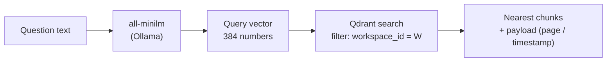

# Embeddings and Vector Databases

Simple explanations of **embeddings**, **vector similarity** and **vector databases**, with EduCopilot examples.

---

## 1. What is an embedding?

An **embedding** is a list of numbers that represents the **meaning** of a piece of text. An embedding model is trained so that texts with **similar meaning** get **similar numbers**.

```text
"A deadlock is when processes wait forever"   →  [0.12, -0.03, 0.88, ..., 0.05]   (384 numbers)
"Processes stuck waiting on each other"        →  [0.10, -0.01, 0.85, ..., 0.07]   (very close!)
"Photosynthesis happens in chloroplasts"       →  [-0.44, 0.61, 0.02, ..., -0.30]  (far away)
```

EduCopilot uses **all-minilm** through Ollama, which produces **384 numbers** per text.

## 2. Measuring similarity

Imagine each vector as an **arrow** in a 384-dimensional space. **Cosine similarity** measures the **angle** between two arrows:

| Cosine | Meaning |
|---|---|
| 1 | Same direction: very similar meaning |
| 0 | Unrelated |
| −1 | Opposite |

```text
cosine(A, B) = (A · B) / (|A| × |B|)
```

EduCopilot's Qdrant collection uses **cosine** distance. Retrieval scores are clipped to the range 0 to 1.

**Why the angle and not the length?** Cosine compares only the direction of two vectors, which is where the model encodes meaning. Two texts about the same topic score high even if their vectors differ in size.

## 3. What is a vector database?

A database built to **store vectors and quickly find the nearest ones** to a query vector, usually with **metadata filters**.

Comparing a question with every chunk one by one works for small collections. It becomes slow for millions of chunks. Vector databases use **approximate nearest neighbour (ANN)** indexes (for example HNSW graphs) to find close vectors quickly without checking everything.

## 4. How EduCopilot uses Qdrant

| Concept | In EduCopilot |
|---|---|
| Collection | One tenant collection per embedding model and chunking profile |
| Point | One chunk: id + 384-dim vector + payload |
| Payload | `workspace_id`, `document_id`, text, `source_type`, `title`, `page_number` or `start_seconds`/`end_seconds`, `generation`, ... |
| Filter | Every search: `workspace_id = <token workspace>` (+ `document_id IN [...]` if sources are selected) |
| Mode | **Embedded** (a local folder inside the backend process) for the demo |

**Diagram: Vector search for one question**



**Multi-tenancy:** one collection holds every student's chunks. Isolation comes from the **payload filter**, whose value comes **only from the verified service token**, plus a final in-code scope check.

## 5. Rules that must always hold

1. **The same model for documents and questions.** Vectors from different models are not comparable.
2. **Matching dimensions.** The backend refuses to search if the collection's vector size is not `VECTOR_SIZE`, and refuses to store a vector of the wrong size.
3. **Re-index when the model changes.** A model change means a new collection (the collection name includes the model and chunking profile).

## 6. Limits of vector search, and why hybrid helps

| Vector search is weak at | Example |
|---|---|
| Exact rare terms | "RAID 5", "IPv6", a formula name |
| Numbers and codes | "Section 4.2", "CS-301" |
| Very short queries | "TLB?" |

**BM25** keyword search is strong exactly there, so EduCopilot combines both. See [BM25, hybrid search and RRF](BM25_AND_HYBRID_SEARCH.md).

## 7. Interview-ready summary

> "Embeddings turn text into vectors so that similar meanings are close together. We use all-minilm (384 dimensions) through Ollama and store the vectors in Qdrant with a payload containing the workspace, the document and the page or timestamp. Every search filters by the workspace from the signed token, so students never see each other's material. Because vector search can miss exact terms, we combine it with BM25."
