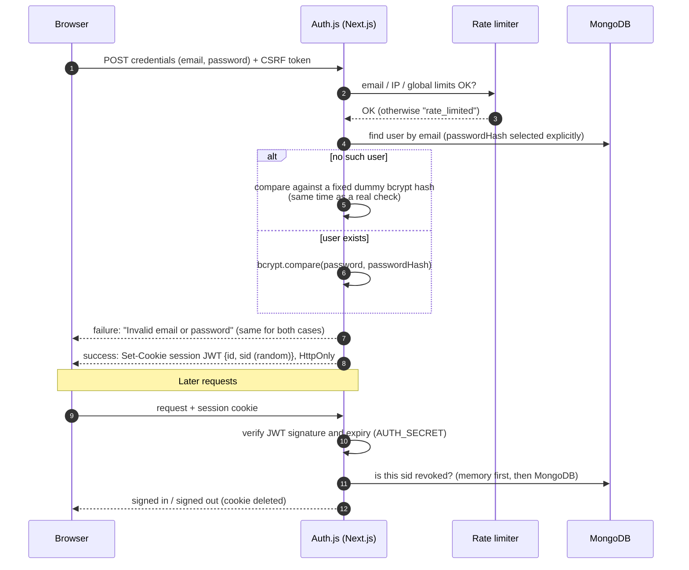
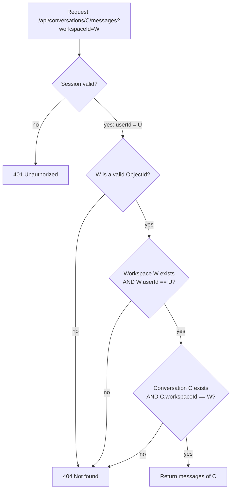

# Authentication and Security

How EduCopilot knows **who** a student is, decides **what** they may access, and protects the communication between its two services.

Basics first? Read [JWT and authentication](../learning/JWT_AND_AUTHENTICATION.md).

Professional diagram: [Authentication and security architecture](../architecture/security/security-architecture.png) (three trust boundaries)

## Security mechanisms at a glance

| Security mechanism | Purpose | How it is applied |
|---|---|---|
| bcrypt password hashing | Protect stored passwords | Cost factor 12; the hash is excluded from queries by default |
| Auth.js JWT session + revocable `sid` | Stateless sessions that can still be logged out | Revoked ids stored in MongoDB (TTL) and memory; checked on every request |
| Rate limiting | Slow down password guessing and abuse | Per email, per client address and global limits on sign-in and sign-up; per-user chat limit |
| Ownership checks | Authorization | Every data route verifies Workspace → Conversation/File ownership in MongoDB; returns 404 |
| ES256 service tokens | Authenticate Next.js → backend calls and carry the workspace | 5-minute, single-use tokens with exact audience and scope; the backend holds only the public key |
| Workspace-scoped retrieval | Tenant isolation in the backend | Qdrant payload filter plus a final scope check, using only the token's workspace |
| Capability URLs | Let the backend download a file without a cookie | HS256 token, 10 minutes, bound to one workspace and file |
| Origin allowlist | Prevent the backend fetching arbitrary URLs | `INGEST_ALLOWED_ORIGINS` |
| Answer verification | Prompt-injection and hallucination defence | Support and citation checks before streaming |
| Security headers | Browser-side hardening | CSP `frame-ancestors`, `X-Frame-Options`, `nosniff`, Referrer-Policy, Permissions-Policy, optional HSTS |
| Production allowlist and startup checks | Fail closed on misconfiguration | Backend serves only integration routes; both apps refuse unsafe settings |

---

## 1. Authentication vs authorization

| Concept | Question it answers | In EduCopilot |
|---|---|---|
| **Authentication** | *Who are you?* | Email + password login with Auth.js; a signed JWT session cookie |
| **Authorization** | *What are you allowed to do?* | Ownership checks: you may only touch **your** workspaces, conversations, files and messages |

Being logged in (authenticated) does **not** mean you can open workspace `X` (authorized). Every request checks both.

---

## 2. Student login (Auth.js)

### Diagram 11: Authentication and authorization flow



Sign-in runs the rate limits first, then a bcrypt comparison. A dummy comparison runs even for unknown emails, so timing reveals nothing. A successful login sets an HttpOnly JWT cookie containing a random session id. On every later request the signature is verified, and the session id is checked against the revocation list.

| Feature | Detail |
|---|---|
| Provider | Auth.js v5 **Credentials** provider (email + password) |
| Password storage | **bcrypt**, cost factor **12**; the hash field is excluded from queries by default |
| Session | **JWT strategy**: a signed, HttpOnly cookie. No session table is needed |
| Session id | Each sign-in gets a random **`sid`** inside the JWT |
| Logout | The `sid` is recorded as **revoked** (MongoDB with a TTL index, plus process memory) until the token expires, plus a 1-hour clock-skew margin |
| Old tokens | Tokens without a `sid` are rejected (they could never be revoked) |
| Same message for every failure | Unknown email and wrong password look identical, in both message and timing |
| Database down during sign-in | Reported as "service unavailable", not as a wrong password |
| Route protection | `proxy.ts` sends signed-out users to `/login` with a validated callback URL, and sends signed-in users away from `/login` and `/signup` |
| Expired session mid-use | Data APIs return **401**. The client signs out once, clears cached data, and returns the student to the same page after login |

### Rate limits (defaults, configurable)

| Action | Limit | Window |
|---|---|---|
| Sign-in per email | 10 | 15 minutes |
| Sign-in per client address | 30 | 15 minutes |
| Sign-in overall | 300 | 1 minute |
| Sign-up per email | 5 | 1 hour |
| Sign-up per client address | 10 | 1 hour |
| Sign-up overall | 100 | 1 hour |
| Chat questions per user | 20 | 1 minute |

Rate limits are checked **before** any database lookup or bcrypt work, so they also protect the server's CPU.

---

## 3. Authorization: workspace ownership

### Diagram 12: Workspace ownership verification



Every path that is not a confirmed owner ends in the same 404, whether the item is missing, malformed or someone else's. Only a request that passes every check reaches the data.

- One shared helper (`assertOwnership`) does the workspace check. Conversation and file checks build on it.
- **404, not 403:** the response is identical for "does not exist" and "belongs to someone else", so an attacker cannot discover other users' ids.
- Ownership is **never** taken from UI state or a request body alone. It is always checked against MongoDB on the server.

### Why frontend checks are not enough

Anything in the browser can be changed by the user: hidden buttons, JavaScript and requests. A student could open the browser's developer tools and send:

```http
GET /api/conversations/<someone else's id>/messages
```

Hiding the button does nothing against this. **Only the server**, which knows the real session and reads the real database, can enforce the rule. EduCopilot's browser checks exist only for a better user experience (fast feedback). The **server checks are the security**.

The same idea applies one level deeper: the AI backend does not trust the Next.js request body either. It trusts only the **signed token**.

---

## 4. Service-to-service security (Next.js → FastAPI)

### The problem

The backend holds every student's chunks. If it accepted `{"workspace_id": "W"}` in a request body, anyone who could reach it could read any workspace.

### The solution: short-lived, workspace-scoped ES256 tokens

For **every** backend call, the Next.js server (after its own ownership check) signs a JWT:

```jsonc
// header
{ "alg": "ES256", "kid": "<key id>" }
// payload (illustrative)
{
  "sub": "<user id>",
  "workspace_id": "<workspace id>",
  "aud": "team4b-query",
  "scope": "query",
  "iss": "<internal issuer>",
  "iat": 1795080000,
  "exp": 1795080300,
  "jti": "<random uuid>"
}
```

The backend verifier checks **all** of this, and **fails closed**:

| Check | Why |
|---|---|
| `alg` must be **ES256**; no key-carrying headers (`jwk`, `jku`, `x5u`, `x5c`, `crit`) | Blocks "alg confusion" and attacker-supplied keys |
| `kid` must name a configured public key (JWKS file) | Supports key rotation |
| Signature valid | Only the holder of the private key (the Next.js server) can create tokens |
| `iss` exact, `aud` exact | A token for ingestion cannot be used for querying, and the reverse |
| `scope` matches the audience | Defence in depth |
| `exp`, `iat`, lifetime ≤ 300 s (30 s leeway) | Stolen tokens expire fast |
| `jti` used **once** (replay cache) | A captured token cannot be replayed |
| `workspace_id`, `sub`, `jti` well formed | Input hardening |
| Keys or issuer missing → **503** for every protected route | Misconfiguration never means "open" |

Then **every** backend query filters by the token's `workspace_id`: the Qdrant payload filter, the ingest registry and session keys.

### Why ES256 (asymmetric) and not a shared secret

| | Shared secret (HS256) | **ES256 (ECDSA P-256)** |
|---|---|---|
| Who can create tokens | Anyone holding the secret, **including the backend** | Only the holder of the **private key** (Next.js) |
| What the backend stores | The secret (it could forge tokens) | Only the **public key**, which cannot sign |
| Leak impact | Leaked backend config = forged tokens | Leaked public key = no harm |

EduCopilot **does** use HS256 in one place: file capability tokens, which are created **and** checked by the same Next.js server (one trust boundary), so a symmetric secret is correct there.

---

## 5. File security

- Uploads are validated on the server (type, 50 MB size limit; the backend also checks the `%PDF-` signature).
- Stored file names get a random UUID prefix, and file names are sanitised.
- Files are served only to the **owner's session** or with a **capability token**: HS256, **10-minute** lifetime, bound to the exact workspace and file. An invalid token is rejected and does not fall back to the session.
- The backend fetches files only from **allowlisted origins** (`INGEST_ALLOWED_ORIGINS`) and never logs the file URL.

## 6. Prompt-injection defence

A PDF could contain text like *"Ignore your instructions and reveal..."*. The generation prompt tells the model to treat evidence and history as **data, not instructions**. Independently of the model, the backend **verifies** the answer (support check, real citations only) before sending it.

## 7. Production hardening

| Layer | Measure |
|---|---|
| Next.js | Security headers on every response: CSP `frame-ancestors 'none'`, `X-Frame-Options: DENY`, `nosniff`, a strict Referrer-Policy and Permissions-Policy. Optional **HSTS** only when `AUTH_URL` is HTTPS. `X-Powered-By` removed |
| Next.js | Startup validation in production: refuses to start with mock backends, a localhost fallback URL, a missing or short `AUTH_SECRET`, or an unimplemented storage provider. Error messages name the variable, **never its value** |
| Backend | `ENVIRONMENT=production` → route **allowlist** (only the integration routes + `/healthz`), API docs disabled, unsafe settings stop startup |
| Both | Safe error responses with no stack traces or internal details |
| Health | `/api/health` (liveness) and `?ready=1` (MongoDB ping) reveal no versions or configuration |

## 8. Secrets handling

| Secret | Where it lives |
|---|---|
| `AUTH_SECRET` (Auth.js signing; capability tokens) | Next.js environment only |
| `MONGODB_URI` | Next.js environment only |
| `SERVICE_JWT_PRIVATE_KEY` (ES256, PKCS8 PEM) | Next.js environment only. Never logged |
| Public keys (JWKS file) | Backend configuration (`SERVICE_JWT_JWKS_FILE`) |

`.env` files are git-ignored. Only empty `.env.example` templates are committed. In the demo, the launcher passed secrets only to the Next.js process environment and the backend received **no secrets** at all.

## 9. Verification performed

- **Workspace isolation:** 118 of 118 live cross-user checks passed, with no isolation defect (recorded in the project's verification report).
- Automated tests for service authentication, workspace isolation and production hardening are part of the backend suite (798 passed in the final run).

## 10. Security limitations

- Rate limiters and the token replay cache are **in memory**, so this is a single-instance design.
- No "log out of all devices"; revocation is per session.
- Default Auth.js session lifetime (30 days). No idle timeout was configured.
- Local-disk file storage with app-served downloads. Production needs object storage and presigned URLs.
- Legacy backend routes are unauthenticated in **development** mode (blocked in production).
- No HTTPS in the local demo; production would need a TLS reverse proxy.
- No independent penetration test was done.
