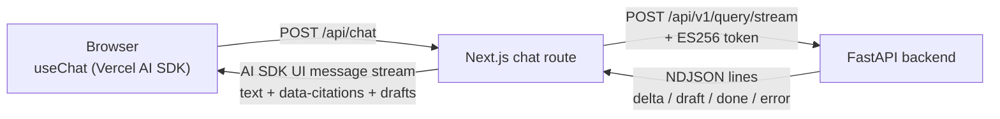

# Chat and Streaming

How the AI tutor chat works, from the moment the student presses **Send** until the cited answer is on screen and saved.

Related: [Question flow diagram](../architecture/DATA_FLOW.md#diagram-5-question-answering-and-citation-generation) · [RAG pipeline](RAG_PIPELINE.md) · [LLM streaming basics](../learning/LLM_STREAMING.md)

Professional diagram: [End-to-end question and answer flow](../architecture/end-to-end-flow/question-answer-flow.png)

---

## 1. The three hops

**Diagram: The three hops of a chat answer**

Each hop has its own format. The Next.js route sits in the middle: it reads the backend's NDJSON and writes the AI SDK stream that `useChat` understands.

| Hop | Format | Why |
|---|---|---|
| Backend → Next.js | **NDJSON** (one JSON object per line) | Simple to produce in FastAPI (`StreamingResponse`) and to parse line by line |
| Next.js → browser | **Vercel AI SDK UI message stream** | `useChat` understands it: text parts, custom data parts, status, stop |

The Next.js route is an **adapter**. It translates the backend's stream into the AI SDK's stream and adds application logic: ownership, citation mapping and persistence.

## 2. What the chat route does

1. **Authenticate:** Auth.js session, or **401**.
2. **Rate-limit:** 20 questions per minute per user by default (`CHAT_RATE_LIMIT_PER_MINUTE`), or **429**.
3. **Validate:** non-blank question, at most **2,000 characters** (otherwise **400**, *before* anything is stored or sent to the backend).
4. **Authorize:** the user must own the workspace **and** the conversation must belong to it, or **404**.
5. **Persist the question first**, with state `generating`. A unique index on `(conversationId, clientMessageId)` stores a resubmitted question **only once**.
6. **Prepare the backend session:** get or create the conversation's `ragSessionId`. If the backend session expired (30-minute TTL), **re-seed** it from the MongoDB history so follow-ups still work.
7. **Source scope:** turn the conversation's selected materials into `document_ids` (or `null` for the whole workspace).
8. **Call the backend** stream with a 5-minute ES256 token (audience `team4b-query`).
9. **Adapt the stream:** forward `delta` text and (if enabled) `draft` parts. On `done`, run **finalisation**.
10. **Finalise:**
    - drop all citations if retrieval found nothing or the answer was a refusal;
    - keep only citations whose `document_id` is a File **in this workspace**;
    - map them to `{fileId, type, pageNumber | timestampSeconds}` with the File's **real name and URL**;
    - send them to the browser as a **`data-citations`** part;
    - save the assistant message (state `answered`) linked to the question (`replyTo`);
    - **auto-title** a new conversation from its first question. This is an atomic update that only replaces the default title "New conversation" and never a title the student set.
11. **Errors** become short, student-friendly messages ("The tutor is temporarily unavailable..."). The question is marked `failed` and keeps its partial answer if there was one.

## 3. Backend stream events

| Event | When | Content |
|---|---|---|
| `draft` | Only with `?draft=1`, while the model writes | Unverified provisional text; shown in a separate, clearly marked area; **never saved** |
| `delta` | After verification | A piece of the **verified** answer |
| `done` | Exactly once at the end | Full answer, session id, `source_attributions`, retrieval metadata |
| `error` | Instead of `done` | A safe error code such as `llm_unavailable` or `internal` |

The backend verifies the answer **before** sending any `delta`. This is why the student never sees text that is later withdrawn. See [RAG pipeline §5.3](RAG_PIPELINE.md#53-answer-verification-team-4c-integration-layer).

## 4. Browser side

- **`useChat`** (from `@ai-sdk/react`) with `DefaultChatTransport` posts to `/api/chat` and manages message state and status (`submitted`, `streaming`, `ready`, `error`).
- A custom hook, **`useChatStream`**, wraps it with:
  - **history seeding** from `GET /api/conversations/{id}/messages`, so the chat reloads after a refresh;
  - **citation attachment** from the `data-citations` part;
  - a **stuck-stream watchdog**: if a stream stops making progress, the chat is rebuilt from the saved history instead of spinning forever;
  - **offline replay**: questions sent while offline wait in a FIFO queue and are sent in order when the `online` event fires;
  - **retry** for a failed question;
  - **Stop**: calls `stop()`, which aborts the fetch. The abort reaches the server and the backend call is cancelled. The question is saved as `stopped`, with any partial text.
- **Rendering:** Markdown (react-markdown + GFM), a **virtualised** message list (TanStack Virtual), and citation chips (`SourceAttribution`).
- **Citation actions:** a PDF chip opens `fileUrl#page=N` in a new tab; a video chip selects that video in the player and **seeks** once the metadata has loaded.
- **Drafts:** each conversation keeps its own unsent text, so switching conversations does not lose what was typed.
- **Session expiry:** a 401 from any route triggers one local sign-out and a redirect to login with the current page as the callback.

## 5. Message persistence states

| `generationState` | Meaning |
|---|---|
| `generating` | Question saved, answer in progress (protected by a short lease) |
| `answered` | Verified answer saved, with citations |
| `failed` | Backend or network error; error text saved; can be retried |
| `stopped` | The student pressed Stop; partial answer kept |

Saving the question **before** calling the backend means a crash, an error or a Stop never silently loses what the student asked.

## 6. Two conversation histories

| Store | Purpose | Lifetime |
|---|---|---|
| MongoDB `messages` | The permanent chat history shown to the student | Until deleted |
| Backend session (FakeRedis/Redis) | Recent turns for follow-up questions and prompt context | 30 minutes since last use |

The Next.js server re-seeds the backend session from MongoDB when it has expired. The two can still **diverge** in some edge cases; this is a known open item.
