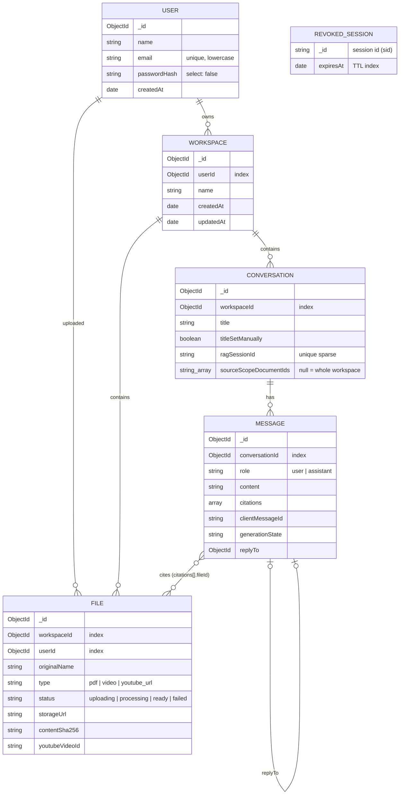

# Database Design

EduCopilot stores its **application data in MongoDB**, accessed **only by the Next.js server** through **Mongoose** models. The AI backend has its own separate stores (Qdrant, a job registry, conversation memory), described at the end.

Everything below matches the Mongoose schemas and the required-index list in the final integrated code.

Professional diagram: [Database and storage architecture](../architecture/database/database-storage-architecture.png)

---

## 1. Why MongoDB and Mongoose

- **MongoDB** is a document database. A chat message with an embedded list of citations is naturally **one document**, with no join table needed.
- **Mongoose** adds what MongoDB lacks by default: **schemas**, validation (`required`, `enum`), defaults, **indexes declared in code**, and TypeScript types inferred from the schema.

### Collections at a glance

| Collection | Purpose | Important fields | Relationships |
|---|---|---|---|
| `users` | Student accounts | `email` (unique), `passwordHash` (hidden by default) | Owns workspaces; uploads files |
| `workspaces` | One subject's private space | `userId`, `name` | Belongs to a user; contains conversations and files |
| `conversations` | Chat threads | `workspaceId`, `title`, `ragSessionId`, `sourceScopeDocumentIds` | Belongs to a workspace; has messages |
| `messages` | Questions and answers | `conversationId`, `role`, `content`, `citations[]`, `generationState` | Belongs to a conversation; citations reference files |
| `files` | Learning materials (PDF or YouTube) | `workspaceId`, `type`, `status`, `contentSha256`, `youtubeVideoId` | Belongs to a workspace and its uploader |
| `revokedsessions` | Logged-out session ids | `_id` (session id), `expiresAt` (TTL) | Referenced by session id inside the Auth.js JWT |

## 2. Entity relationships

**Diagram: MongoDB entity-relationship model**



A user owns workspaces. Each workspace contains files and conversations, and each conversation has messages. Messages point to the files they cite through embedded citation entries, and an answer points to its question through `replyTo`. `REVOKED_SESSION` stands alone: it is looked up by the session id stored in the login cookie.

### The ownership chain

```text
User ──owns──▶ Workspace ──contains──▶ Conversation ──has──▶ Message
                    └──────contains──▶ File
```

Every protected request walks this chain on the server. For example, a message is reachable only if `Message.conversationId → Conversation.workspaceId → Workspace.userId` equals the signed-in user. See [Authentication and security](AUTHENTICATION_AND_SECURITY.md#diagram-12-workspace-ownership-verification).

## 3. Collections

### 3.1 `users`

| Field | Type | Rules | Purpose |
|---|---|---|---|
| `name` | String | required, trimmed | Display name |
| `email` | String | required, **unique**, lowercased, trimmed | Login identity |
| `passwordHash` | String | required, **`select: false`** | bcrypt hash (cost 12). Excluded from queries unless explicitly requested |
| `createdAt` | Date | automatic | — |

### 3.2 `workspaces`

| Field | Type | Rules |
|---|---|---|
| `userId` | ObjectId → User | required, indexed |
| `name` | String | required, trimmed |
| `createdAt`, `updatedAt` | Date | automatic |

### 3.3 `conversations`

| Field | Type | Rules | Purpose |
|---|---|---|---|
| `workspaceId` | ObjectId → Workspace | required, indexed | Ownership |
| `title` | String | required | Default "New conversation", auto-titled from the first question |
| `titleSetManually` | Boolean | optional | Set on rename; auto-titling never overwrites a manual title |
| `ragSessionId` | String | **unique, sparse** | The backend conversation-memory session id (UUID v4) |
| `sourceScopeDocumentIds` | [String] | default `null` | Selected materials for this conversation (`null` = whole workspace) |

### 3.4 `messages`

| Field | Type | Rules | Purpose |
|---|---|---|---|
| `conversationId` | ObjectId → Conversation | required, indexed | Ownership and history |
| `role` | String | `user` or `assistant` | — |
| `content` | String | required | Question or answer text |
| `citations` | [Citation] | optional | Embedded sub-documents (see below) |
| `clientMessageId` | String | optional | Client-generated id; deduplicates resubmitted questions |
| `generationState` | String | `generating`, `answered`, `failed`, `stopped` | Lifecycle of a question |
| `generationAttemptId`, `generationLeaseExpiresAt` | String, Date | optional | Lease for an in-progress answer |
| `generationError`, `partialAnswer` | String | optional | Saved on failure or Stop |
| `replyTo` | ObjectId → Message | optional | Links an answer to its question |
| `createdAt` | Date | automatic | Ordering |

**Citation sub-document** (no own `_id`):

| Field | Type | Notes |
|---|---|---|
| `fileId` | ObjectId → File | required |
| `type` | `pdf` or `video` | required |
| `pageNumber` | Number | PDF citations |
| `timestampSeconds` | Number | Video citations |

### 3.5 `files`

| Field | Type | Rules | Purpose |
|---|---|---|---|
| `workspaceId` | ObjectId → Workspace | required, indexed | Ownership |
| `userId` | ObjectId → User | required, indexed | Uploader |
| `originalName` | String | required | Name shown to the student and used in citations |
| `type` | `pdf`, `video`, `youtube_url` | required | (`video` exists in the schema, but uploads of video files are rejected) |
| `storageUrl` | String | required | Local file URL or YouTube URL |
| `storageProvider`, `publicId` | String | optional | Storage details (`publicId` = stored file name) |
| `status` | `uploading`, `processing`, `ready`, `failed` | default `uploading` | Lifecycle |
| `processingError` | String | default `null` | Student-friendly failure reason |
| `ingestionId` | String | optional | Backend job id |
| `uploadIdempotencyKey` | String | **unique, sparse** | Safe retries of the same upload |
| `contentSha256` | String | optional | Duplicate-content detection |
| `youtubeVideoId` | String | optional | Duplicate-video detection |
| `processingLeaseOwner`, `processingLeaseExpiresAt` | String, Date | optional | Recovery of stuck processing |
| `pageCount`, `durationSeconds`, `sizeBytes` | Number | optional | Metadata |
| `currentIngestionGeneration` | Number | default 0 | Defined for an earlier version's contract, in which a separate Team 4A service wrote it. In the final integrated build, nothing reads it, and the only writer is Team 4C's one-off migration script, which backfills `0`. The backend tracks generations in its own ingest registry instead. Clean-up needs agreement with Team 4A |
| `extractedPages`, `extractionAttempted` | — | optional | Older fields not used by the current ingestion path (a known clean-up item) |
| `createdAt`, `updatedAt` | Date | automatic | — |

### 3.6 `revokedsessions`

| Field | Type | Rules |
|---|---|---|
| `_id` | String | The session id (`sid`) of a logged-out session |
| `expiresAt` | Date | **TTL index**: MongoDB deletes the record automatically when the session would have expired anyway |

## 4. Indexes (12 required)

A script (`db:indexes`, with a `--check` mode) creates or verifies exactly these:

| Collection | Index | Options | Purpose |
|---|---|---|---|
| users | `{email: 1}` | unique | One account per email; login lookup |
| workspaces | `{userId: 1}` | — | List a user's workspaces |
| conversations | `{workspaceId: 1}` | — | Workspace-scoped queries and deletes |
| conversations | `{ragSessionId: 1}` | unique, sparse | One backend session belongs to one conversation |
| messages | `{conversationId: 1}` | — | History and cascade deletes |
| messages | `{conversationId: 1, clientMessageId: 1}` | unique, partial (only when `clientMessageId` is a string) | A submitted question is stored exactly once |
| files | `{workspaceId: 1}` | — | Workspace file lists and deletes |
| files | `{userId: 1}` | — | Owner lookups |
| files | `{uploadIdempotencyKey: 1}` | unique, sparse | Retried uploads reuse one File |
| files | `{workspaceId: 1, contentSha256: 1}` | unique, partial | One File per identical PDF content per workspace |
| files | `{workspaceId: 1, youtubeVideoId: 1}` | unique, partial | One File per YouTube video per workspace |
| revokedsessions | `{expiresAt: 1}` | TTL, `expireAfterSeconds: 0` | Automatic clean-up |

**Sparse vs partial:** a *sparse* unique index ignores documents **missing** the field. A *partial* unique index ignores documents that do not match a filter (here: the field is a string). Both let many documents have "no value" while still enforcing uniqueness among documents that do have one.

Status: all 12 were verified on an **isolated test database**. The live database was checked earlier (10 of 10, before two indexes were added) but was not re-checked after.

## 5. Data lifecycle

| Event | What happens |
|---|---|
| Sign-up | `users` document created (password hashed) |
| Create workspace | `workspaces` document with `userId` |
| Add material | `files` document (`uploading` → `processing` → `ready`/`failed`) + backend chunks |
| New conversation | `conversations` document titled "New conversation" |
| Ask a question | user `messages` document (`generating`), then an assistant document (`answered`), or the question is updated to `failed`/`stopped` |
| Rename conversation | `title` updated, `titleSetManually: true` |
| Delete a file | Backend document deleted **first**, then the bytes, then the `files` document |
| Delete a conversation | Its messages, its backend session and the conversation |
| Delete a workspace | Backend documents for every file, bytes, files, messages, conversations, workspace |
| Logout | `revokedsessions` record until the session's natural expiry (TTL clean-up) |

## 6. Where every piece of data lives

| Data | Store | Owner | Isolation |
|---|---|---|---|
| Accounts, workspaces, conversations, messages, file records, session revocations | MongoDB | Next.js | Ownership chain checked on every request |
| Uploaded PDF bytes | Local upload folder (one sub-folder per workspace) | Next.js | Served only to the owner or with a capability token |
| Chunk text, 384-dim vectors, chunk metadata | Qdrant tenant collection | Backend | `workspace_id` in every point payload; every search filters on it |
| Ingest jobs, documents, generation numbers, active generation | Ingest registry (JSON files on disk) | Backend | Keyed by workspace |
| Recent conversation turns and summary (30-minute TTL) | Conversation memory (in-process FakeRedis in local/demo storage mode; Redis server only in external mode) | Backend | Keys include the workspace id |

Shared identifiers: `File._id` = backend `document_id`; `Workspace._id` = token `workspace_id`; `Conversation.ragSessionId` = backend `session_id`.
