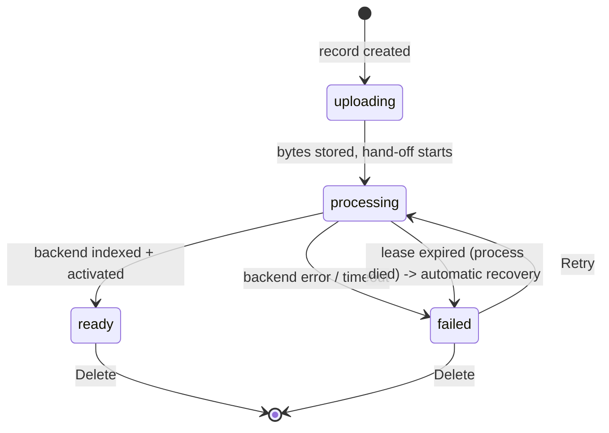

# File Ingestion (Learning Materials)

This document covers the **learning-material lifecycle** from the application's side: how a PDF or YouTube link is accepted, stored, handed to the backend, tracked, retried, recovered and deleted. The backend's text processing (extraction, chunking, embeddings) is in the [RAG pipeline](RAG_PIPELINE.md#3-ingestion-turning-material-into-searchable-chunks).

Diagrams: [PDF ingestion](../architecture/DATA_FLOW.md#diagram-3-pdf-ingestion-pipeline) · [YouTube ingestion](../architecture/DATA_FLOW.md#diagram-4-youtube-ingestion-pipeline)

Professional diagram: [PDF and YouTube ingestion architecture](../architecture/ingestion/ingestion-architecture.png)

---

## 1. Supported materials

| Type | Accepted | Notes |
|---|---|---|
| PDF | Yes, up to **50 MB** | Must have a text layer (scanned PDFs are not supported) |
| YouTube link | Yes | Video id is extracted from the URL; the video must have captions |
| MP4 / video file | **No (by design)** | Rejected with a clear message; needs a local transcription model that is not part of the product path |

Validation happens **in the browser** (for fast feedback) **and on the server** (for security).

## 2. File status lifecycle

**Diagram: File status lifecycle**

Every file ends in `ready` or `failed`. A failed file can return to `processing` through Retry, and a file whose processing lease expires is moved to `failed` automatically so it never stays stuck.

| Status | Meaning for the student |
|---|---|
| `uploading` | The record exists and the bytes are being stored |
| `processing` | The backend is extracting, chunking and indexing |
| `ready` | The material can be used in chat |
| `failed` | Something went wrong; a student-friendly reason is shown, with **Retry** |

## 3. Upload flow (PDF)

1. **Browser:** the student picks a PDF. The client checks type and size, then uploads with **XHR**, because XHR reports upload progress and `fetch` does not. A progress bar shows real bytes sent.
2. **Server:** session check → workspace ownership check → type/size validation → **SHA-256** of the content.
3. **Duplicate check:** if the same content already exists in this workspace, the existing material is reused. A unique MongoDB index on `(workspaceId, contentSha256)` makes this safe even when two uploads race.
4. **Store:** the bytes are written to the local upload folder under the workspace id, with a random UUID in the file name.
5. **Hand-off:** the server creates a **capability URL** for the file (valid 10 minutes, bound to this workspace and file), signs a **service token**, and calls `POST /v1/ingest`.
6. **Wait:** ingestion is **synchronous**, and the server waits up to **5 minutes**.
7. **Result:** the File becomes `ready` or `failed`. Backend errors are mapped to student-friendly messages; technical details stay in the server logs.

## 4. YouTube flow

1. The server extracts the **11-character video id** from the URL and rejects invalid links.
2. **Duplicate check** on `(workspaceId, youtubeVideoId)`, also backed by a unique index:
   - the video already exists → it is returned as it is (never re-ingested), marked `reusedExisting`;
   - the same video is still being added → **409**, with a message pointing to the in-progress item.
3. Hand-off to `POST /v1/ingest` with `file_type: youtube`. The backend fetches the captions itself.

## 5. Idempotency (safe retries)

The upload request can carry an **idempotency key**. A unique sparse index on `uploadIdempotencyKey` makes a network retry of the *same* upload reuse one File instead of creating two.

## 6. Retry

`POST /api/workspaces/{id}/files/{fileId}/retry` re-runs the hand-off for a **failed** file with the **same `document_id`**. The backend starts a **new generation**, so old and new chunks never mix. A retry of a file that is not in a retryable state returns **409**.

## 7. Recovering files stuck in "processing"

**Problem:** ingestion runs inside the upload HTTP request. If the server process dies mid-way, the File stays `processing` forever. There is no job queue to notice.

**Solution: a lease.**

- Every hand-off attempt takes a **lease** on its File, renewed every **30 seconds** while the request is alive.
- A lease that has not been renewed for **6 minutes** is considered abandoned.
- When files are listed or uploaded, one atomic MongoDB `updateMany` marks files with an **expired lease** as `failed`. Retry then works normally.
- All status writes are **conditional on still owning the lease**. A late result from an old attempt therefore cannot overwrite a newer retry.

## 8. Deletion

Order matters (diagram: [Data flow: deleting material](../architecture/DATA_FLOW.md#deleting-material-or-a-workspace)):

1. **Backend first:** `DELETE /v1/documents/{id}`. The document stops being retrievable immediately and its chunks are removed. If this fails, the delete stops (502) and nothing is half-deleted.
2. Delete the stored bytes.
3. Delete the File record.

Deleting a workspace does this for every file, then removes messages, conversations and the workspace.

## 9. Serving files to the student

`GET /api/local-storage/{workspaceId}/{publicId}` serves the bytes if:

- the requester has a valid session **and owns the workspace**, or
- the URL carries a valid **capability token** for exactly that workspace and file. The backend uses this path to fetch the PDF.

Citations open this URL with `#page=N`.

## 10. Production notes

Local-disk storage works for **one server only**. A production deployment would replace it with object storage (for example S3-compatible storage) and presigned URLs. In production mode the app **refuses** to start with an object-storage provider configured, because none is implemented. See [Deployment](../guides/DEPLOYMENT.md).
